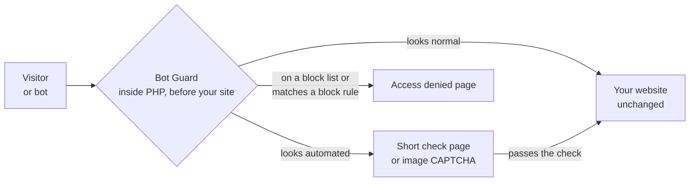
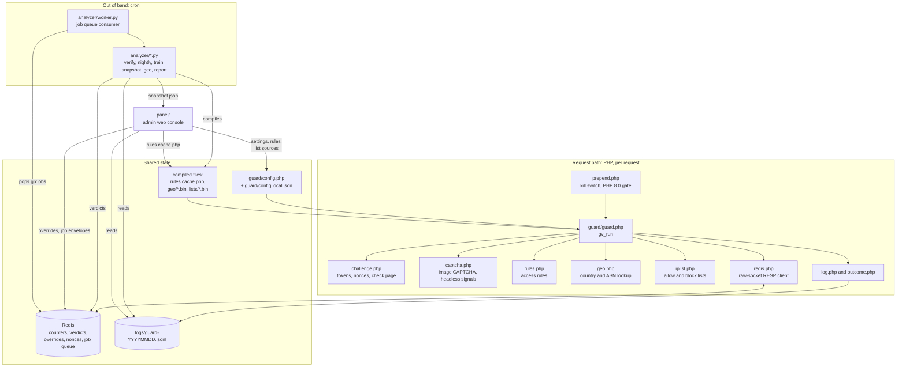

# Bot Guard

[](https://github.com/rasulsh/bot-managment-system/actions/workflows/ci.yml)

Bot Guard is a self-hosted filter that sits in front of a **PHP website** and keeps
scrapers, fake search-engine crawlers and other unwanted automated traffic away from
it. It runs inside PHP, before your application, so it needs no plugin and no change to
your site's code. It is meant for people who run their own PHP site or shop (WordPress,
OpenCart, Laravel, plain PHP) on a server where they can edit PHP settings and add
scheduled tasks.

It **starts by only watching and logging**; nothing is blocked until you turn that on,
step by step. If anything inside it fails, your site keeps working (it "fails open").

What it is **not**: it is not a firewall, not DDoS protection and not a malware scanner;
it does not see files that the web server serves without PHP (images, CSS); it cannot
protect a non-PHP application; and it slows down and exposes a patient scraper with a
real browser rather than stopping it for good ([known limits](#216-known-limits)).

There is **no `LICENSE` file** in this repository, so no licence badge is shown; see
[Licence and credits](#licence-and-credits).

## Contents

| | |
|---|---|
| **[Part 1: For site owners and operators](#part-1--for-site-owners-and-operators)** | No programming needed |
| 1.1 | [What Bot Guard does, in plain words](#11-what-bot-guard-does-in-plain-words) |
| 1.2 | [What you need before you start](#12-what-you-need-before-you-start) |
| 1.3 | [Installation paths](#13-installation-paths) |
| 1.4 | [First login and a tour of the panel](#14-first-login-and-a-tour-of-the-panel) |
| 1.5 | [Reading the dashboard](#15-reading-the-dashboard) |
| 1.6 | [Safe rollout plan](#16-safe-rollout-plan) |
| 1.7 | [Everyday tasks (recipes)](#17-everyday-tasks-recipes) |
| 1.8 | [Good practices and common mistakes](#18-good-practices-and-common-mistakes) |
| 1.9 | [Troubleshooting by symptom](#19-troubleshooting-by-symptom) |
| 1.10 | [Glossary](#110-glossary) |
| **[Part 2: For developers and power users](#part-2--for-developers-and-power-users)** | Precise and complete |
| 2.1–2.5 | [Architecture](#21-architecture-overview) · [Request lifecycle](#22-request-lifecycle-and-precedence) · [Fail-open and degraded mode](#23-fail-open-model-and-degraded-mode) · [Performance budgets](#24-performance-budgets) · [Requirements and support matrix](#25-requirements-and-support-matrix) |
| 2.6–2.9 | [Installation by environment](#26-installation-by-environment) · [Application and CMS integration](#27-application-and-cms-integration) · [Scheduled jobs](#28-scheduled-jobs) · [Configuration model](#29-configuration-model) |
| 2.10–2.13 | [Data formats](#210-data-formats) · [Analyzer](#211-analyzer) · [Security model](#212-security-model) · [Extending the system](#213-extending-the-system) |
| 2.14–2.17 | [Testing and CI](#214-testing-and-ci) · [Upgrade and rollback](#215-upgrade-and-rollback) · [Known limits](#216-known-limits) · [Contributing](#217-contributing) |
| **[Licence and credits](#licence-and-credits)** | |

Placeholders used below: `<install-dir>` (where you put this repository),
`<site-root>` (your site's public web folder), `<web-user>` (the account PHP runs as),
`<php-binary>`, `<python-binary>`, `example.com`, and the documentation address ranges
`192.0.2.0/24` and `2001:db8::/32`. Replace them with your own values.

---

# Part 1 — For site owners and operators

You run a website and can log in to a hosting control panel. You do not need to write
code. Every technical word is explained the first time it appears (and again in the
[glossary](#110-glossary)). The only commands are copy-and-paste ones, each with a
line that says what it does.

## 1.1 What Bot Guard does, in plain words

Every time someone asks your server for a page, the request first goes through Bot Guard
and then, if it is allowed, on to your website.



**Bad traffic it targets.**

- **Scrapers**: programs that copy your whole catalogue or prices. Many announce
  themselves with a *User-Agent* (the name a program sends with each request) such as
  `python-requests` or `curl`.
- **Fake crawlers**: programs that claim to be "Googlebot" to get a free pass. Real
  Google and Bing crawlers are recognised by a background check (a reverse DNS lookup,
  done by the *analyzer* in the background), so the claim alone is not trusted.

**Two ways to run: monitor and enforce.**

| Mode | What happens | Your visitors |
|---|---|---|
| **Monitor** (the default) | Every request is scored and written to a log, together with what Bot Guard *would* have done. Nothing is changed. | Notice nothing. |
| **Enforce** | The action is really applied: check page, CAPTCHA, "too many requests" or "access denied". | Real visitors pass automatically; bots are stopped or slowed down. |

Enforcement is switched on per feature, never all at once (see the
[rollout plan](#16-safe-rollout-plan)). Each *rule* you create also has its own
monitor/enforce mode. While the install secret is still the placeholder `CHANGE_ME`,
enforcement is forced off, so a half-finished install cannot affect your site.

**What a visitor can see.**

| They see | When | What it is |
|---|---|---|
| **Nothing** | Almost always | Normal visitors, search-engine crawlers that were verified, and anyone in monitor mode. |
| **A short "please wait" check page** | Only once the *challenge* is enforced, on a visitor's first page (then a cookie lasts 7 days by default) | The page runs a small test in the browser and reloads by itself. It is sent with HTTP status 503. A browser with JavaScript and cookies passes in about a second; a simple script does not. |
| **An image CAPTCHA** (type the characters shown) | Only when a rule with the action *Image CAPTCHA* matches, or an optional escalation or budget feature is on | Needs the PHP GD extension. Without it, visitors get the short check page instead. |
| **"429 Too Many Requests"** | Only once rate limiting is enforced and a client sends far too many requests | A plain text page; it asks the client to retry after 60 seconds. |
| **"403 Forbidden"** (access denied) | A block rule, an enforced block list or a very high suspicion score (only when the matching feature is enforced), or an operator *deny* (always, also in monitor mode) | A plain text page. |

> **The check page ships in Persian.** The sample file `guard/config.php` contains
> Persian texts (right-to-left). Change them to your language in the panel under
> **Settings → Challenge page text**, or edit `strings` in `guard/config.php`, before you
> enforce the challenge. If you remove the `strings` block, English texts are used.

## 1.2 What you need before you start

| You need | Why | How to check | If it is missing |
|---|---|---|---|
| **PHP 8.0 or newer** on the site | Bot Guard is PHP code | In your hosting panel, look for "PHP version" (cPanel: *MultiPHP Manager*), or run `<php-binary> -v` over SSH | On PHP below 8.0 the guard does nothing and your site runs as before; it leaves one line in `logs/guard-errors.log`. |
| **Redis** (a small in-memory database) reachable from PHP | Counters (how many requests), verdicts, overrides, one-time check tokens | Ask your host, or `redis-cli ping` over SSH must answer `PONG` | The guard still runs but is *degraded*: no rate limits, no per-visitor overrides, no crawler verdicts. Rules, IP lists, scoring and the check page keep working. |
| **Python 3.9 or newer** with the packages in `analyzer/requirements.txt` | The *analyzer*: verifies real crawlers, scores visitors, feeds the panel | `<python-binary> --version` over SSH | No crawler verification (real Googlebot then shares one small budget), no panel dashboard numbers, no behaviour scores. The guard itself keeps working. |
| **Scheduled tasks (cron)** | Runs the analyzer jobs and the daily log rotation | Your panel's "Cron Jobs" page, or `crontab -l` over SSH | Jobs never run; the dashboard says so with alerts. |
| **SSH (command-line) access** | One-time install steps | Ask your host | Ask a developer or the host to do the install ([1.3](#13-installation-paths)). |
| **Writable folders** for the PHP account | `logs/` for the log; with the panel also `guard/`, `geo/`, `lists/`, `panel/` and the top folder | After the first request, files appear in `logs/` | Nothing is logged; the guard still works. See [docs/13-PANEL-WEB-ACCESS.md](docs/13-PANEL-WEB-ACCESS.md#3-permissions-and-ownership). |
| **PHP command line (`php`)** on the same server | The analyzer and the log-rotation script read the guard's settings through it | `<php-binary> -v` over SSH: it must say `(cli)` and 8.0 or newer (not `cgi-fcgi`) | Analyzer jobs refuse to write ("Redis settings are not confirmed"). On cPanel / CloudLinux cron's default `PATH` can find a CGI build first: start the crontab with `PATH=/usr/local/bin:/usr/bin:/bin`. |
| *Optional:* **PHP GD with FreeType** | Draws the image CAPTCHA | `php -m` should list `gd`; cPanel: EasyApache → PHP Extensions | CAPTCHA rules fall back to the short check page; the dashboard warns while a CAPTCHA is configured. |
| *Optional:* the **PHP `opcache`** extension | Keeps the compiled rules in memory (speed) | `php -m` lists `Zend OPcache` | Works, a little slower with many rules. |

**Message you can send to your hosting provider**

> Hello, I want to install a PHP request filter (Bot Guard) on my account. Could you
> please confirm or enable the following?
>
> 1. PHP 8.0 or newer for my site, and the PHP command-line program `php`.
> 2. The ability to set `auto_prepend_file` for my site (in `.user.ini`, the PHP INI
>    editor, or `php.ini`).
> 3. A Redis server I can reach from PHP and from Python on this server (host and port or
>    a socket path, with the eviction policy `noeviction` if the server allows setting it).
> 4. Python 3.9 or newer, with `pip` (or a virtual environment) so I can install `redis`,
>    `numpy`, `scikit-learn` (and optionally `maxminddb`).
> 5. Cron jobs (scheduled tasks) for my account, as often as every minute.
> 6. SSH access.
> 7. Optionally the PHP `gd` extension with FreeType.
>
> Please also tell me whether PHP and cron run as the same user on my account. Thank you.

## 1.3 Installation paths

Pick the row that matches you. The exact steps are in [Part 2 §2.6](#26-installation-by-environment)
and in [docs/03-SETUP.md](docs/03-SETUP.md).

| Your situation | Route | How well it is verified |
|---|---|---|
| **Shared hosting with cPanel / CloudLinux** (SSH, PHP INI editor, cron) | Put the folder outside the public web folder, set `auto_prepend_file`, add cron jobs. The docs cover the CloudLinux crontab command, the MultiPHP INI Editor and EasyApache. | Written for it; **cPanel itself is not run in CI** (Apache and OpenLiteSpeed are). |
| **Plesk** or **DirectAdmin** | The same three things are needed: a place to set `auto_prepend_file`, cron, and SSH. | **Not covered** by the docs or by CI. Use the generic steps, expect to adapt, and test carefully. |
| **VPS or dedicated server** (you are root) | Part 2 §2.6 for Apache or OpenLiteSpeed. | Apache 2.4 with `mod_php` and OpenLiteSpeed are **tested in CI**; Nginx with PHP-FPM is **expected to work but untested**. |
| **Local test on your computer** | `php -S` with the included test router and a throw-away Redis. See [Try it locally](#try-it-locally). | Tested in CI. Never deploy the test configuration. |

**Ask a developer (or your host) if** you have no SSH access; you cannot add cron jobs;
Redis is not available; you use Nginx; your site is not PHP; you sit behind a CDN or
reverse proxy and are not sure how it passes visitor addresses; PHP and cron run as
different users; or you are about to enforce on a shop where a mistake loses orders.

### Try it locally

Safe to try on your own computer. It uses a public test secret and very strict limits,
so **never use it on a real site**:

```bash
# Start a throw-away web server with the guard in front of a test page.
php -S 127.0.0.1:8080 scripts/dev-router.php &
# Send test requests and print a table of what the guard did (needs Redis for some rows).
bash scripts/guard-test.sh http://127.0.0.1:8080
```

## 1.4 First login and a tour of the panel

The panel is an optional web page for one operator. Install it with one command run in
the install folder; it asks for a user name and a password of **at least 12 characters**:

```bash
# Create the panel login (until you run this, every panel address answers a bare 404).
<php-binary> <install-dir>/panel/setpass.php
```

Then make the panel reachable, add its web path to `exempt_paths` so the guard never
challenges you out of your own panel, and open it
(for example `https://example.com/gv-admin/`, with the final slash). The steps,
permissions and checks are in [docs/13-PANEL-WEB-ACCESS.md](docs/13-PANEL-WEB-ACCESS.md).
To restrict the panel to your own addresses, set `ip_allowlist` in
`panel/panel.config.php`. Five wrong passwords lock a login for 15 minutes, and a
session lasts 12 hours by default.

The left menu has thirteen pages. Nothing on any page changes anything until you press a
button, and every change is written to the **Audit** trail.

### Dashboard
*What it is for:* the one-page health and traffic summary. *Look at first:* the red and
amber **Needs attention** box (see [1.5](#15-reading-the-dashboard)), then **Protection**
(monitor, partly enforcing, or enforcing). *Safe to change:* nothing except the
**kill switch** (stops the guard completely; see
[the emergency recipe](#emergency-turn-bot-guard-off-completely-and-back-on)).

### Logs
*What it is for:* searching what the guard did, request by request (up to 200 rows per
page). *Look at first:* filter by **action** (`act`): `challenge`, `403`, `429`.
A row with **shadow** `sh = 1` is something that was *only logged*, not done.
*Safe to change:* everything: filters and the CSV export only read. From a row you can
open a **Quick block** (a pre-filled monitor rule).

### Live requests
*What it is for:* watching requests **as they arrive**, instead of reloading Logs. It follows
today's log (the last 1, 5, 15 or 60 minutes first, then every new row) or replays a fixed
**start / end** (server time zone shown). *Controls:* refresh every 2, 5, 10 or 30 seconds or
paused (it also pauses while the pointer is over the table and stops while the tab is hidden),
200, 500 or 1000 rows on screen, quick toggles (**blocked, challenged, CAPTCHA, rate limited,
monitor-only would-act, allowed, verified crawlers**) and every Logs filter with include / exclude.
*Reading it:* rows are coloured by outcome (and always say the word), reasons are the same badges as
in Logs; a strip shows requests per second, the count of each outcome, distinct addresses and devices
and a per-second chart; **Top right now** lists the busiest addresses, devices, User-Agents, paths and
countries (press one to filter). A row opens a **details drawer** (all fields, the rule or list that
matched, the identity history, and the quick actions of *Temporary blocks & allows* for the address
and the device); **Watch** pins an address or device so its rows are always shown and marked;
**Export CSV** saves the rows on screen. *Safe to change:* everything: the page only reads the log
(no Redis, no writes). Monitoring operators and administrators only (never the Demo role); the
quick actions are administrator only.

### Identity
*What it is for:* everything Bot Guard knows about **one visitor** (an IP address or a
device id). *Look at first:* this page, whenever someone says they were blocked.
*Safe to change:* you can add an Allow or Deny here.

### Temporary blocks & allows (the *Overrides* route)
*What it is for:* a single address or a single device, for a **limited time**: **Allow** (let
through), **Block** (refuse), **Challenge** (the check page) or **CAPTCHA** (the image test) until
the client holds a token. It expires by itself, which makes it the right tool for dynamic mobile
addresses. Time presets are 5 min, 15 min, 30 min, 1 h, 6 h, 24 h, 7 d and 30 d, or your own
number of minutes (at most 30 days); each entry shows the time left and the exact expiry, and
can be extended, shortened or removed. *Safe to change:* yes. Adding an Allow is the five-second
fix for a stuck customer. **Every override acts immediately, also in monitor mode** and for a client in the holdout (an operator action like a rule in enforce mode); only the kill switch stops them. **Allow beats Block, Block beats CAPTCHA,
CAPTCHA beats Challenge**; a verified crawler keeps its pass and an enforced allow list is checked
first. For an address many people share (a mobile network, carrier-grade NAT `100.64.0.0/10`) the
page warns you: prefer a challenge and a short time. Every log row, the Identity page and the Live
page have quick buttons (*Block 15 min*, *Challenge 1 h*, *CAPTCHA 1 h*, *Allow 1 h*, *Custom...*)
for the address and the device.

### Rules
*What it is for:* your own "if the User-Agent contains X, then block / challenge /
CAPTCHA / only log" rules, optionally also by path, country or network. Each rule has a
**mode** (Monitor or Enforce), an **action** and a **priority** (lower number is checked first;
the first matching rule wins). *Look at first:* press **Install starter set** (16 rules for
common scraper tools, all switched off and in monitor mode), then read the **hits** and the
**Preview impact** box. *Safe to change:* creating rules in Monitor mode is safe; switching a
rule to Enforce asks you to look at the preview and tick an acknowledgement.

### GeoIP
*What it is for:* a database that guesses the **country** (and the network owner, the *ASN*) of
an address, so rules can use them. You provide the database file; Bot Guard compiles it.
*Look at first:* the database age (the panel warns after 45 days). *Safe to change:* uploading,
compiling and the lookup tester are safe. Country guesses are wrong for VPN users
([recipe](#use-country-rules-safely)).

### IP lists
*What it is for:* named **allow** and **block** lists of addresses and address ranges, pasted
or uploaded as a file. Six tabs: **Lists**, **Editor**, **Entries**, **Feeds**, **Lookup tester**,
**Compile**. *Look at first:* the **Lookup tester** (type an address, see which list holds it).
*Safe to change:* start a list in Monitor mode; an Allow list is a hole by design, so keep it
short ([recipe](#allow-a-partner-or-payment-gateway-server)).

**IP feeds (Feeds tab).** A feed keeps a provider's published IPv4 ranges up to date from an HTTPS URL
(daily, weekly or by pressing *Update now*). Four presets are offered: **Google common crawlers** and
**UptimeRobot** go to an **allow list** (reasonable: verified crawlers and your own uptime monitor);
**ArvanCloud** and **Cloudflare** go to **Trusted CDN ranges** (`cdn_ranges`), and only if your site is
behind that CDN. **Never put a CDN's ranges in an allow list:** if your site is behind it, every visitor
arrives from those addresses and the whole site would be allowed; even if it is not, anyone can send
requests from those networks (Cloudflare Workers, WARP) and skip the guard. A feed that fails keeps
its last good entries; an update that would remove more than half of them waits for your confirmation;
ranges wider than /16 in an allow list wait for you to accept them for that feed. Details:
[Part 2, IP feeds](#ip-range-feeds).

### Replay
*What it is for:* "what would have happened last week if I changed the score threshold or the
analyzer weights?" It re-runs the guard's own decision over your recent logs and shows how
many more requests would be challenged, blocked or limited. *Look at first:* the number of
**humans newly restricted**. *Safe to change:* it writes nothing. It does not cover rules or IP
lists (use their own previews).

### Models
*What it is for:* the analyzer's two machine-learning models. *Safe to change:* training
always creates a **candidate** and never replaces the live model; **promote** is an explicit
step. You can leave this page alone: the machine-learning signals ship switched off, and the
project's own review ([docs/06-KNOWN-LIMITS.md](docs/06-KNOWN-LIMITS.md#signals-from-the-analyzer-leave-them-off-for-now)) advises leaving them off.

### Settings
*What it is for:* every operating setting, in tabs: Enforcement, Signals and weights, Rate
limits, Tokens and challenge behaviour, Challenge page text, Holdout and outcome capture,
Exemptions and honeypot, Network and proxies, Bots and verification, Log storage, GeoIP,
CAPTCHA, Analyzer. *Look at first:* **Enforcement** and **Challenge page text**. *Safe to
change:* anything with a tooltip, one thing at a time; a before/after table is shown before
saving. The secret, Redis settings and panel login are deliberately not here.

### Config file
*What it is for:* the same settings as raw text (`guard/config.local.json`), with a live syntax
check and automatic backups (the newest 20 are kept). *Safe to change:* only if you are
comfortable with JSON; Settings is easier.

### Jobs
*What it is for:* file permission problems of the install (with the commands that fix them), whether each background job ran, when, and what its last error was; the
crontab check; and the queue of actions you started from the panel. *Look at first:* any job
that is **late**, **failing** or **never** ran. *Safe to change:* buttons start a job that the
`worker` cron job then runs within a minute.

### Audit
*What it is for:* an append-only record of who changed what, when and from which address
(settings, rules, lists, overrides, kill switch, logins, updates). *Safe to change:* it is read-only.

### Users and My account
*What it is for:* **Users** (administrators only) lists who can sign in, creates accounts, changes roles, disables, resets passwords and deletes
([Users and roles](#users-and-roles)). **My account** (everybody) shows your role and changes your own password. *Safe to change:* disable
instead of delete when unsure.

### Update
*What it is for:* installing a newer version of Bot Guard from the GitHub ZIP, without SSH or git, and
rolling it back. *Look at first:* the installed version and the green "writable" badge. *Safe to change:*
nothing changes until you review the list of files and enter your password
([Updating Bot Guard](#updating-bot-guard)).

## 1.5 Reading the dashboard

The page runs top to bottom (full layout and numbers: [docs/15-DASHBOARD.md](docs/15-DASHBOARD.md)):

1. **Status strip:** protection mode (*monitor only*, *partly enforcing*, *enforcing*), the kill switch (*Stop the guard* asks *Are you sure?* inline first; *Start* needs no confirmation), open alerts (critical / warning; the first critical alert is always shown, the rest of the list opens by itself on a wide screen and is collapsed on a phone), how many jobs are healthy, the age of the snapshot and the version.
2. **Six tiles**, each for the last 24 hours with the change against the 24 hours before and a sparkline, each a link to **Logs** with the same filter: requests, allowed, challenged (with the solve rate), blocked, rate-limited and **would act if enforced**. The last one counts requests a rule, list or score would have blocked, limited or challenged if it were enforced: while you are in monitor mode it is the number to watch.
3. **Requests per hour** (24 h, or the **7 d** tab): each column is one hour, stacked by outcome; the dashed line is the number of different addresses.
4. **Rollout readiness** (Type: *Rule*, *IP list · block*, *IP list · allow*) lists every enabled rule and IP list that is in **Monitor** mode with its hits in 24 h and 7 d, the addresses and devices it touched and the share of hits that carried a valid token (people who passed the check). *Ready to enforce* = at least 20 hits in 7 d and under 5 % with a valid token; *Review first* = 5 % or more; *Too few hits* and *No hits in 7 d* mean there is not enough evidence. It is a hint, not a verdict. Next to it the **funnel** shows, for the check page and the image CAPTCHA, how many visitors were *served* the page, *solved* it (a token was issued, or the CAPTCHA was answered) and *passed* (made an allowed request with that token afterwards), plus how many *failed* an attempt, and the median CAPTCHA solve time. Each stage is a subset of the one before, so the numbers only go down, and the percentage is of *Served*.
5. **Top lists** (tabs: IPs, devices, User-Agents, paths, countries, ASNs): requests, share of the 24 h total, an outcome mix bar, and a quick action (Identity and Block / allow for an address or a device, Logs and Live for the rest). Operators and administrators only; the Demo role sees only the tiles and the chart.
6. **System** and a collapsed **More**: jobs, Redis and the enforce switches, log storage, models and classifier label progress, GeoIP and feeds, file permissions; score histograms, status codes, reasons, coverage and holdout.

The heavy numbers come from the snapshot (the `dash` block, built by the analyzer every 15 minutes), so a card shows **Stale** when the snapshot is older than an hour. Alerts are still read live.

The **Needs attention** box lists problems, **critical** (red) first, then **warning** (amber).
Whether an alert fires is decided from live checks (file reads and one cheap Redis command), not from numbers in the possibly stale snapshot. Job rows use the same
colours plus green (ok) and grey (never ran).

**Critical alerts: what to do**

| Alert (short) | What to do |
|---|---|
| Guard data is reachable from the web | Move the folder outside the public web folder or fix the web-server rules; run the [exposure check](#26-installation-by-environment) |
| Redis is unreachable (degraded mode) | Start Redis or fix `redis` settings in `guard/config.php`; meanwhile nothing is rate-limited |
| Most requests logged in degraded mode | Same as above: Redis down or refusing writes |
| A required job failed, or is late | Open **Jobs**, read the first error line; most often `GV_PYTHON` or missing packages ([1.9](#19-troubleshooting-by-symptom)) |
| Panel jobs stuck in the queue | The `worker` cron job is missing or stuck: add or fix it |
| Free disk space is below the log floor | The guard has **stopped writing logs**. Free disk space; check log rotation |
| A GeoIP database is missing or damaged while a country rule is enabled | Upload and compile a database, or disable the rule |
| An IP-list file is missing or corrupt, or its compile failed | **IP lists → Compile**; the guard treats the list as empty meanwhile |
| An allow list lost an entry wider than /8 | Review the list on the Compile tab; a huge allow range would have switched the guard off for much of the internet |
| `guard/rules.json` is invalid | Open **Rules**; the guard ignores what it cannot read |
| Required cron entries are missing | Add the lines shown on the **Cron setup** card, then **Jobs → Check again** |

**Warnings** (amber) include: a job ran but did nothing useful; no or stale snapshot; analyzer
and panel time zones differ; `secret` or `holdout_salt` still a placeholder; Redis is not on
`noeviction`; GD missing while a CAPTCHA is configured; entries dropped from an IP list; the
rules cache is older than the rules file; the crontab could not be read.

### Reading the logs

A log row keeps SHORT codes (`UA_SCRIPT`, `SH_RULE:12`, `IPL_BLOCK:3`, ...): they are written on every request, so they are never renamed. The panel shows the full
name next to the code everywhere a reason appears (**Logs**, **Identity**, the dashboard lists): a badge such as *Rule matched: Block scrapers* with the code in small
monospace beside it, the explanation as a tooltip, and a **monitor only** marker on every `SH_` code (the guard would have acted and did nothing). A rule or list id is
resolved to its name and links to it. The Logs **Reason** filter offers the full names (the value stays the code), and the CSV export keeps the short columns and adds
a last column with the reasons spelled out. Every code, the other short fields (`act`, `tok`, `ovr`, `botv`, `sh`, `hold`, `cap`) and their values:
[docs/14-REASON-CODES.md](docs/14-REASON-CODES.md).

## 1.6 Safe rollout plan

Do these in order. Each step should look quiet before the next. The project's own
checklist ([ROLLOUT.md](ROLLOUT.md)) plans roughly **8–10 weeks**, almost all waiting.

1. [ ] **Install in monitor mode** with a real `secret` ([Part 2 §2.6](#26-installation-by-environment)). Check that a log line appears per request.
2. [ ] **Check the jobs and alerts**: all required cron jobs show *ok* on **Jobs**, no red alerts. Add your own server-to-server addresses to the exemptions ([1.7](#allow-a-partner-or-payment-gateway-server)).
3. [ ] **Wait at least 14 days** in monitor mode ([ROLLOUT.md](ROLLOUT.md) Stage 1; [docs/03-SETUP.md](docs/03-SETUP.md) Step 7). Optionally set `holdout_pct` to 2 now, so a small unenforced control group fills up.
4. [ ] **Install the starter rules** (Rules → Install starter set) and **enable them in Monitor mode**.
5. [ ] **Read the hits and the Preview impact** for several days. A rule that matches visitors who carried a valid token, or more than 50 distinct devices, is shown in red: do not enforce it.
6. [ ] **Switch single rules to *Challenge*** (not Block) in Enforce mode, one at a time, and watch the **challenge success rate** (the project's guidance is to stay at or above about 95 %).
7. [ ] **Only then switch single rules to *Block***, the clearest ones first.
8. [ ] **Global enforcement last**, one switch at a time, waiting several days between them: `enforce.block`, then `enforce.challenge`, then `enforce.ratelimit` (Settings → Enforcement). Before switching on the challenge, exempt every machine-to-machine address. Replace the shipped rate limits by your own measured numbers before the third.
9. [ ] Leave the three machine-learning signals **off** (their limits are described in [docs/06-KNOWN-LIMITS.md](docs/06-KNOWN-LIMITS.md#signals-from-the-analyzer-leave-them-off-for-now)).

At any step, the [kill switch](#emergency-turn-bot-guard-off-completely-and-back-on) returns
your site to normal immediately.

## 1.7 Everyday tasks (recipes)

### Check whether a real customer was blocked, and unblock them

1. Ask the customer for their public IP address (a "what is my IP" website shows it) and roughly when it happened.
2. Open **Identity**, paste the address and search. Read the latest rows: `act` is `403`, `429` or `challenge`, and `sh` must be `0` (a shadow row did not affect them). The **reasons** (`rs`) say why, for example `RULE:<id>`, `IPL_BLOCK:<id>` or a score reason.
3. To let them through now: **Temporary blocks & allows → Allow**, paste the address (or the device id from Identity) and choose a **short time limit** such as 1 hour. It applies from their next request, whatever the enforcement switches say.
4. **Exception:** if the reason is `IPL_BLOCK:<id>`, an Allow override does **not** help, because an enforced block list is decided first. Remove the address from that list, or put it in an **allow list**.
5. Fix the cause (disable or narrow the rule, or exempt the path) and remove the override.

### Block a bad bot by its User-Agent

1. Find the User-Agent in **Logs** and press **Quick block**, or go to **Rules → New rule**.
2. On the **Conditions** tab, set *User-Agent condition* (Match *include*, Type *contains* or *exact*) and the value. Avoid very short values: they also match real browsers.
3. On the **Action** tab choose *Block (403)* and **Mode: Monitor**. Keep **Skip verified crawlers** ticked. Save.
4. Open the rule and read **Preview impact**. Wait a few days and check the hits (they update with the snapshot job).
5. Switch the **Mode** to *Enforce*. Tick the acknowledgement. A User-Agent is chosen by the client, so this stops lazy tools, not a program that pretends to be a browser.

### Show the image CAPTCHA to suspicious visitors and choose a level

1. Check **Settings → CAPTCHA**: the status line must not say GD is missing.
2. Choose the **level** and press the preview button. Level 2 is the default (5 digits, light distortion). Levels: 1 = 4 digits; 2 = 5 digits; 3 = 5 digits with more distortion; 4 = 6 letters and digits, heavy distortion; 5 = 7 letters and digits, heaviest. Higher levels are hard on small phones, and there is **no audio alternative**.
3. Create a rule with the action *Image CAPTCHA* (for example on `HeadlessChrome`), in **Monitor** mode first. Read the preview ("would get a CAPTCHA") and later the CAPTCHA row on the dashboard (solve rate, median time).
4. Switch the rule to Enforce.

Sample images from the docs (levels 1, 3 and 5):

  

### Allow a partner or payment-gateway server

Machines have no browser cookie, so they would be challenged. Two routes:

1. **By web address (best for gateways and webhooks).** In **Settings → Exemptions and honeypot**, add the address prefix (for example `/payment-callback/`) to **exempt paths**. *Risk:* an exempt path skips **everything**, including blocks; keep the list short, and end each entry with `/`.
2. **By server address.** In **IP lists → New allow list**, add the partner's address (for example `192.0.2.10`), Monitor first, then Enforce. *Risk:* an allow list skips rules, scoring, limits and the challenge for those addresses. **Never allow-list a mobile operator's address range or a shared one** (everyone behind it would skip the guard).

### Block a list of addresses from a file

1. **IP lists → New block list.** Give it a name, keep **Mode: Monitor**, and **paste or upload** a plain text file: one IPv4/IPv6 address or range (for example `198.51.100.0/24`) per line, `#` for comments. A **temporary entry**: add `# expires=2026-11-30` (valid through the end of that day, UTC) or `# expires=2026-11-30T14:30` (UTC, to the minute); the compile ignores an expired entry and removes its line, and the `worker` job (every minute) recompiles as soon as the earliest `expires=` time (stored as `next_expiry` in `lists/lists-status.json`) has passed, so an expired entry stops matching within about a minute; the nightly job is the safety net. A date that is not real refuses the line.
2. Fix any lines the page reports (nothing is saved until you accept the valid ones). Entries covering private or your own addresses, or very wide ranges, are refused unless you tick "I know what I'm doing".
3. Compile (small lists compile when you save; big ones need the `worker` cron job). Use the **Lookup tester** and read the hits as `SH_IPL_BLOCK:<id>` in Logs.
4. Switch the list to **Enforce**. Block lists go stale and addresses are reassigned: refresh them.
5. Limits: 50 lists, 300,000 lines and 16 MiB per list text; copy bigger files into `lists/` over SFTP.

### Use country rules safely

1. Upload a GeoIP database (**GeoIP** page) and compile it; turn on **Settings → GeoIP → log country**.
2. Create the rule in **Monitor**, then **Challenge**; use **Block** last. Read the impact preview.
3. **VPN warning:** a country is a guess. A rule like "everyone not in country X" blocks your own customers who use a VPN, a foreign mobile network or a foreign CDN.
4. Keep **Skip verified crawlers** ticked: Googlebot and Bingbot crawl from US addresses.
5. An address missing from the database is *unknown* and matches nothing (neither "in" nor "not in"). Keep the database fresh (monthly `geo` cron job; the panel warns at 45 days).

### Emergency: turn Bot Guard off completely and back on

There are two switches; both act from the very next request.

- **Panel:** **Dashboard → Kill switch → Stop the guard** (asks for confirmation). Use *Start the guard* to turn it back on. It creates the file below.
- **File (works when the panel is broken).** Create an empty file named `guard.off` in the **top** install folder, next to `prepend.php` (not inside `guard/`):

```bash
# Turn the guard off: every request now passes unchecked.
touch <install-dir>/guard.off
# Turn it on again.
rm <install-dir>/guard.off
```

While it exists the guard logs nothing and decides nothing. It is the only instant switch
(`.user.ini` changes can take up to about five minutes). Both switches bypass all rules and lists.

### Export logs for someone else to look at

1. **Logs:** set your filter and press **Export CSV (this page)**. It contains the rows on the page only (at most 200), not all filtered results.
2. For a whole day, copy the daily files `<install-dir>/logs/guard-YYYYMMDD.jsonl` (finished days are compressed to `.gz`). One JSON object per line.
3. **Privacy:** logs hold visitor addresses, paths and the first 100 characters of query strings (which may include tokens from e-mail links). Share them only with people who may see that data.

### Users and roles

Several people can have their own login, each with one of three roles:

| Role (label) | Can see | Can change |
|---|---|---|
| **Administrator** (`admin`) | everything | everything, including **Users** and **Update** |
| **Monitoring operator** (`operator`) | every report and page an administrator sees, except secrets, the raw **Config file** page, **Update** and **Users** | **nothing**: no form of any kind, except signing out and changing **their own** password |
| **Demo** (`demo`) | only high-level numbers: the dashboard's request counts and trends, the protection state and counts of rules, lists and jobs. Never an address, device, User-Agent, path, rule pattern, list entry, log row, error text, file path, setting or another user's name | nothing except signing out |

The top bar always shows who is signed in and with which role. A Monitoring operator sees the same pages as an administrator except
Config file, Update and Users; their buttons are disabled, and the server refuses (HTTP 403, and a line in the audit trail) anything they
try anyway. A Demo user gets a different page built only from numbers, with the banner *Demo mode — sensitive data hidden*.

**Create a user.** *Users*, fill *Create a user* (username a-z, 0-9, `.`, `_`, `-`, 3 to 32 characters; role; a first password of at least 12
characters that is not the username), press **Create user**. Tell the person the password over a safe channel; they change it under
*My account*. **Disable a user.** *Users*, the row, **Disable**: their sessions end at once and they cannot sign in (the message stays the
generic "Wrong username or password"). **Enable** brings the account back; **Reset password** ends their sessions too; **Delete** asks for
confirmation. Safety rules: you cannot disable, demote or delete yourself, and the **last enabled administrator** is protected.

**Recover admin access** (nobody can sign in, or the last administrator is locked out). On the server, as the account that owns the install:

```bash
php <install-dir>/panel/setpass.php
```

Answer `y`, then enter an administrator name and a new password: a new administrator is created, or an existing account is reset (new password,
role administrator, enabled, its sessions ended). Other accounts are not touched. If `panel/users.json` is damaged the script offers to move it
aside (`users.json.bad-<time>`) and start a new store with the administrator you enter. The same script, answered with `y` to the last question,
also logs out every session.

**First upgrade.** Nothing to do: the existing login becomes an enabled administrator with the same password. Sessions that are open stay open.
Rolling back to the previous version signs that first account in with the password it had before the upgrade (`panel/panel.config.php` is
not rewritten by the panel); run `setpass.php` for it if you changed that password under *My account* in the meantime.

### Updating Bot Guard

You need the ZIP of the version you want: on GitHub open the repository, **Code, Download ZIP** (the `master` branch)
or download a release ZIP. Nothing else.

1. Open the panel, page **Update**. Check that **Install directory writable** says **Yes**. If it says **No**, the web server user cannot write the project: update over SFTP instead, or fix the ownership.
2. Under **Upload a ZIP** choose the file and press **Upload and check**. Nothing is changed yet. A ZIP that is damaged, is not this project, contains unsafe paths or has a PHP syntax error is refused with the reason.
3. Read the **review**: old version to new version, how many files are added, changed and removed, what changed (the changelog) and any warnings (a downgrade, the same version, a `.git` folder, a changed `requirements.txt` or cron script). Your configuration, rules, lists, logs and models are listed as **protected** and are never touched.
4. Enter your panel password and press **Apply update**. The updater also sets the file modes itself (scripts 755, other files 644, nothing writable by group or others), so a server that had 666 modes is repaired by the update. The guard is switched off for a few seconds, the files are swapped, then the new code is checked in a fresh request. If the check fails the update rolls itself back. If the page after **Apply** is the web server's 403 instead of the result, open **Update** and press **Run the check now** (the same check, inside the panel); after more than 2 minutes the dashboard says the guard is OFF and shows the shell command `php <install-dir>/updates/verify.php <stamp>`. **Write down the recovery token** shown on the result page: it works once, for 24 hours.
5. Look at the result page: it tells you whether a `pip_sync` job was queued (Python packages), whether the crontab needs a new line, and whether the **permission check** found anything (it lists the exact `chmod` commands). Cron lines should call the scripts through `bash` (`bash <install-dir>/scripts/analyzer-cron.sh worker`), which works even when a script has lost its execute bit. Open **Jobs** and **Dashboard** and make sure nothing turned red.

**Undo an update:** page **Update**, history, **Roll back**. If the panel itself no longer opens, use the recovery token at `<panel-address>/recover.php?token=<token>` or, with a shell, `php <install-dir>/updates/rollback.php`.

The first time you use this feature on an install that was set up by copying files, copy the new release over the install once by hand (it contains the Update page itself); from then on use the panel. A git checkout can be updated this way too, but the working tree then differs from git: to go back to git updates run `git stash && git pull` (or `git checkout -- . && git pull`) after a rollback or after restoring the files from the ZIP.

## 1.8 Good practices and common mistakes

| Do | Do not |
|---|---|
| Start with **Challenge**, block later | Switch everything to *Enforce* on day one |
| Keep **Skip verified crawlers** on in every rule | Block by country without it: Google and Bing crawl from US addresses |
| Keep `verify`, `snapshot`, `worker`, `nightly` and log rotation running | Forget the cron jobs: without `verify` real crawlers never leave the shared budget |
| Exempt machine-to-machine paths **before** enforcing the challenge | Leave payment callbacks, webhooks, feeds, cron URLs and uptime monitors un-exempted |
| Exempt your admin area (staff make thousands of requests) | Put staff in the per-device hourly/daily budget |
| Keep allow lists short and exact | **Allow-list a mobile operator's range or `100.64.0.0/10`** |
| Keep the GeoIP database and block lists fresh | Trust a country as proof of identity |
| Give overrides a short time limit | Leave an Allow override forever |
| Keep `holdout_pct` small (0–5) or 0 | Treat the holdout as a bypass |
| Back up `guard/config.php` (it holds the secret; keep it `chmod 600`) | Commit the secret to version control |
| Put Redis on `maxmemory-policy noeviction` and its own database or prefix | Share an evicting Redis: it can silently delete overrides and verdicts |

## 1.9 Troubleshooting by symptom

| Symptom | Likely cause | What to do |
|---|---|---|
| **Customers keep seeing the check page** | Cookies or JavaScript are blocked in their browser; their network changes address while the page loads (the check is tied to the address, `challenge.bind_ip`); a shared address used up the per-address token limit `limits.mint` | Ask them to enable cookies; in **Logs** look for `nonce_bad`, `pow_bad` and `mint_limited`; raise `limits.mint` before lowering it; on networks that rotate addresses ask a developer about `challenge.bind_ip`; if the challenge success rate falls below ~95 %, switch the challenge back to monitor while you investigate |
| **Google stopped crawling** | The `verify` job is not running; a block or country rule without *Skip verified crawlers*; a block list that contains crawler addresses (it is checked before the crawler pass) | Check **Jobs** for `verify`; in **Logs** search the User-Agent `Googlebot` and read `act` and the reasons; fix the rule or list; use the kill switch if urgent |
| **Dashboard says jobs never ran** | No cron entries; wrong path; wrong `GV_PYTHON`; cron runs as another user | Open **Jobs** (the crontab check) or run `bash <install-dir>/scripts/cron-check.sh` over SSH; add the lines the **Cron setup** card shows |
| **Dashboard numbers look frozen** | The `snapshot` cron job stopped | Check **Jobs → snapshot**; the snapshot is rewritten every 15 minutes |
| **Panel not reachable** | No login created yet (bare 404); wrong web path; `.htaccess` not honoured; your address is not in `ip_allowlist`; five wrong passwords lock the login for 15 minutes | [docs/13-PANEL-WEB-ACCESS.md, section 7](docs/13-PANEL-WEB-ACCESS.md#7-troubleshooting); a browser you already signed in from is not locked out by someone else guessing your username; clear a lock-out now with another administrator (*Users* → *Clear a login lockout*) or `php <install-dir>/panel/setpass.php --unlock-user NAME` (`--unlock-ip ADDRESS`, `--unlock-all`) |
| **Nothing appears in the log** | `auto_prepend_file` path wrong or not reloaded yet (`.user.ini` takes up to ~5 minutes); the page came from a cache without running PHP; `logs/` not writable; disk below the floor | [docs/11-TESTING-PIPELINE.md](docs/11-TESTING-PIPELINE.md); read `logs/guard-errors.log` |
| **CAPTCHA image missing, visitors get the check page instead** | PHP GD (with FreeType) not installed in the **web server's** PHP | Install `gd`; the dashboard shows a warning while a CAPTCHA is configured |
| **Everything shows "unknown" country** | No GeoIP database compiled, or *log country* is off | **GeoIP** page: upload, **Compile now**; Settings → GeoIP |
| **The site feels slower** | Redis slow or on another host; rules read without OPcache; disk full | Typical cost is a fraction of a millisecond ([2.4](#24-performance-budgets)); check `ms` in Logs; keep Redis local; save rules from the panel to rebuild the cache |
| **Job fails with "cannot import"** | `GV_PYTHON` not set or wrong | Install `analyzer/requirements.txt` in a virtual environment and put `GV_PYTHON=<python-binary>` at the top of the crontab |
| **Running a job by hand from SSH fails: "preflight: python3 (source: default) cannot import: No module named 'numpy'"** | A shell has no `GV_PYTHON` (cron gets it from its crontab), so the bare `python3` ran, which has none of the packages | Nothing to set any more: the wrapper now picks the Python in this order: `GV_PYTHON` from the environment, `GV_PYTHON` read from your crontab, `<install-dir>/.venv/bin/python`, then `python3`, and records the choice as `"python": "... (source: crontab)"` in `analyzer/.jobstatus-<mode>.json` (Jobs page). If it still says `(source: default)`, create the virtualenv (`python3 -m venv .venv && .venv/bin/pip install -r analyzer/requirements.txt`) or add `GV_PYTHON=<install-dir>/.venv/bin/python` to your crontab. A `php` that is not the command-line build (cgi-fcgi) falls back to `/usr/local/bin/php` when that is one |
| **Job warning "verify: Redis unavailable" / "Redis settings not confirmed (the PHP bridge failed)", jobs exit 0 but store nothing** | The `php` that cron runs is not the command line build (cron's minimal `PATH` finds `php-cgi` / `cgi-fcgi`, which prints HTTP headers first, so the settings cannot be read). *Redis unavailable* without "not confirmed" is a real connection problem | Run `bash scripts/cron-check.sh` (it names the php cron would run), add `PATH=/usr/local/bin:/usr/bin:/bin` (or `GV_PHP=/usr/local/bin/php`) at the top of the crontab. The analyzer now passes `-q` and ignores a header block, and warns once naming the binary |
| **Redis alert: "can silently delete"** | Redis eviction policy is not `noeviction` | Set `maxmemory-policy noeviction` or use a dedicated Redis |

## 1.10 Glossary

| Term | Meaning |
|---|---|
| **User-Agent** | The name a program announces with each request (a browser says "Chrome", a script may say `curl`). Chosen by the client, so it can lie. |
| **IP address** | The numeric address of the machine that asked (IPv4 like `192.0.2.7`, IPv6 like `2001:db8::7`). Many people can share one (mobile networks, offices). |
| **CIDR range** | A block of addresses written as `192.0.2.0/24` (256 addresses). |
| **Crawler** | A program run by a search engine that reads your pages. |
| **Verified crawler** | A crawler whose claim was confirmed by a reverse DNS lookup (the analyzer's `verify` job). |
| **Token** | The signed cookie (`_gv`) a visitor gets after passing the check; valid 7 days by default. |
| **Challenge** | The short "please wait" check page a browser passes by itself. |
| **Proof of work** | A small calculation the check page makes the browser do (about 65,000 hash attempts at the default), cheap for one visitor, costly for a program fetching millions of pages. |
| **CAPTCHA** | A test where you type the characters shown in an image. |
| **Monitor mode** | Log what would be done; do nothing. |
| **Enforce mode** | Really apply the action. |
| **Shadow** | A log row marked `sh = 1`: what *would* have happened. |
| **Holdout** | A tiny, fixed slice of visitors (0–5 %) that is measured but never blocked, to estimate what the guard misses. |
| **Rule** | One "if conditions match, then action" entry, with its own mode and priority. |
| **Allow list** | Addresses that skip the guard. Powerful and risky. |
| **Block list** | Addresses that get "403 Forbidden". |
| **Override** | A single-address or single-device Allow/Deny with a time limit, stored in Redis. |
| **GeoIP** | A database that guesses the country of an address. |
| **ASN** | The number of the network (an ISP or hosting company) that owns an address. |
| **Redis** | A fast in-memory database that holds counters, verdicts and overrides. |
| **Cron job** | A task the server runs on a schedule. |
| **Analyzer** | The Python programs run by cron that verify crawlers and feed the panel. |
| **Kill switch** | The panel button or the `guard.off` file that turns the guard off instantly. |
| **Fail open** | When something breaks, requests are allowed rather than blocked. |
| **Degraded mode** | Redis is unavailable: no counters, overrides or verdicts, but the site stays up. |

---
# Part 2 — For developers and power users

Precise and complete. Every file, function, key and default below was checked against the
code on `master`. Depth lives in [`docs/`](docs/README.md); this part summarises and links.

## 2.1 Architecture overview

Three cooperating programs that exchange data only through **Redis**, the **daily JSONL logs**
and a few **compiled files**. The panel is optional; the analyzer is optional for the guard
itself but feeds crawler verdicts and the dashboard.



| Component | Folder / main files | Role |
|---|---|---|
| Entry point | `prepend.php` | `auto_prepend_file` target. Skips CLI, skips below PHP 8.0 (one throttled line in `logs/guard-errors.log`), returns when `guard.off` exists, then requires `guard/guard.php` in `try/catch (\Throwable)`. |
| Guard | `guard/guard.php` | Config load and overlay, request facts, scoring, decision, `gv_run()`. Superglobals are read in one place (`gv_facts`). |
| Challenge | `guard/challenge.php` | HMAC token (`gv_tok_*`), nonce (`gv_nonce_*`), proof of work (`gv_pow_ok`), the 503 check page and its inline JavaScript. |
| CAPTCHA | `guard/captcha.php`, `captcha-font.ttf` | GD-drawn image page, handshake, headless-signal scoring. |
| Rules | `guard/rules.php` | Validation, matching, generated cache, starter set. |
| GeoIP / lists | `guard/geo.php`, `guard/iplist.php` | Binary search in compiled range files. No Redis, no DNS. |
| Redis client | `guard/redis.php` | Raw sockets, pipelines, fail-fast, circuit breaker, key namespace (`gv_key`, `gp_key`). |
| Logging | `guard/log.php`, `guard/outcome.php` | One JSONL row per request; optional second row after the application (`capture_outcomes`). |
| Analyzer | `analyzer/` | `run_verify.py`, `run_nightly.py`, `snapshot.py`, `worker.py`, `geo.py`, `iplist.py`, `report.py`, `replay.py`, `ctl.py`, models and features. |
| Panel | `panel/index.php`, `auth.php`, `data.php`, `config_io.php`, `health.php`, `rules.php`, `iplists.php`, `geo.php`, `jobs.php`, `views/`, `lang.php` | Explicit route table; no dynamic includes; writes validated JSON, never PHP; no shell. |
| Operations | `scripts/` | Cron wrappers, rotation, checks, tests, benchmarks. |

Full detail: [docs/02-ARCHITECTURE.md](docs/02-ARCHITECTURE.md).

## 2.2 Request lifecycle and precedence

Derived from `gv_run()` in `guard/guard.php` (read in this order; the first branch that
returns or exits ends the request, and **every branch logs exactly one row**). "Redis" counts
network round trips, "files" counts file reads that are not OPcache hits.

| # | Step | Cost | Can return |
|---|---|---|---|
| 0 | **`prepend.php`**: CLI skip; PHP < 8.0 gate; **kill switch** `guard.off` (top directory) | 1 `is_file` | app runs, nothing logged |
| 1 | **Config + facts**: `gv_cfg_load()` (defaults → `config.php` → `config.local.json`; placeholder secret forces every `enforce.*` off), `gv_facts()`, log policy | config include + 1 overlay JSON read, 0 Redis | — |
| 1b | **Enforced IP block list** (`lists/block.bin`): applies only with a real secret, not exempt, and no enforced allow-list hit | 2 `open()`s, a binary search, 0 Redis | `403` (act `403`) |
| 2 | **Handshake intercept** (`POST` with `X-GV`): 6-part nonce → CAPTCHA handshake; else HMAC, binding, age, proof of work, then one pipeline (nonce claim `SET NX`, `allow:<ip>`, counters, escalation flag) | 1 Redis round trip | `204` token issued, `202` reload into CAPTCHA, `403` (`nonce_bad`, `nonce_replay`, `pow_bad`), `429` (`mint_limited`) or, in monitor, the app |
| 2b | **Operator test switch** (`challenge.test_key`, needs a real secret): `?gv_test=KEY` sets a signed 10-minute cookie; the cookie shows the real check page to that browser | 0 Redis | `302`, or the check page |
| 3 | **Exemptions**: `exempt_paths` prefixes, `exempt_params` on `exempt_params_paths` only | pure | app (act `exempt`) |
| 3a | **IP lists**: enforced **allow** hit → like an operator allow; monitor lists only add `SH_IPL_*` to `rs` | 0 Redis | app (act `allow_override`) |
| 3b | **Access rules** (`gv_rules_load` → `gv_rules_match`, first by ascending priority); GeoIP lookups only if `geo.log` or a rule needs them | OPcache include, 0 Redis | — (result used below) |
| 4 | **Token**: HMAC check of the `_gv` cookie → device id and level (`p` / `c`) | pure | — |
| 5 | **Redis connect + one pipeline of every `GET` this request can need** (`botbad`/`botok`, `rep`/`ml`/`clf`, `allow`/`deny` by device and IP, `hp`, CAPTCHA budget `cpi`, escalation flag `cesc`) | 1 round trip | — |
| 5a | **Known crawler pass** (`known_bots`): unverified claims draw on `limits.bot_unverified`; a refuted claim (`botv=bad`) loses the pass and gets `+35 BOT_FAKE`; an enforced rule that does not skip verified crawlers replaces the pass | +1 round trip (counters) | app (act `allow_bot`) |
| 5b | **Link-preview pass** (`preview_bots`): site-wide budget `limits.preview` per name; needs Redis | +1 round trip | app (act `allow_preview`) |
| 6 | **Honeypot** (`honeypot_path`): sets `hp:<ip>` for 7 days, serves a 404; fires regardless of `enforce.*` | 1 command | `404` (act `404_hp`) |
| 7 | **Offline verdicts** (`rep`, `ml`, `clf`) read from step 5 | 0 | — |
| 7c | **Operator overrides**: `allow` (device or IP) wins over `deny` and stops here; `deny` acts at once (no enforce switch, no holdout; reason `OVR_DENY`); a temporary `captcha` / `challenge` (`gv:chal:`) feeds step 9 as an enforced rule would (reason `OVR_CAPTCHA` / `OVR_CHALLENGE`), needs no enforce switch and is read in the same pipeline | 0 | app (act `allow_override`) |
| 8 | **Static score** `gv_score` (+ `BOT_FAKE`); rule reason appended | pure | — |
| 9 | **Rule action** (`gv_rule_act`), escalation flag, CAPTCHA budget | pure | — |
| 10 | **Rate counters**: device (`window`, hour, day), `ip_ua`, `ip`, in one pipeline | 1 round trip | — |
| 11 | **Decision**: `gv_effective_score`, `gv_decide` (deny override → score ≥ `hard_block_score` on a gated request → over a limit → no token), then `gv_served` applies the `enforce.*` switches and the **holdout**; an enforced rule can only add (`403`, or upgrade to challenge/CAPTCHA) | pure | `403`, `429`, check page (503), CAPTCHA page, or app (`allow`; `sh=1` in monitor/holdout) |

**Precedence rules that follow from the order**

1. Kill switch beats everything; exempt paths beat every enforcement (an exempt request skips even an operator deny and a block list).
2. An **enforced IP allow list beats an enforced block list** (the block check at 1b is skipped), a Redis **allow override**, a rule and the challenge. An enforced allow list also makes a Redis *deny* override useless.
3. A Redis **allow override does not beat an enforced block list** (1b runs before Redis is read) but does beat rules, scoring and counters.
4. Rule actions are operator actions: their own `mode` decides, **not** `enforce.*`, and the holdout never suppresses them. A `challenge` rule applies only to a request without a valid token; a `captcha` rule also only to HTML navigations without a level-`c` token.
5. The holdout (`holdout_pct`, ≤ 5) suppresses the score block and the plain challenge, **never** a `429`, an operator deny or a rule.
6. `captcha.escalate_score`, a 202 handshake and a CAPTCHA served while Redis is down are separate paths documented in [docs/02-ARCHITECTURE.md](docs/02-ARCHITECTURE.md#image-captcha-and-the-headless-signals).

## 2.3 Fail-open model and degraded mode

Any exception in the guard is swallowed (`prepend.php`, `guard_exception` in `guard-errors.log`)
and the application runs. Failure of a dependency can only make the guard **more permissive**.

| Unavailable | Effect | Still enforced |
|---|---|---|
| **Redis** (down, breaker armed, refusing writes) | Rows carry `rd=1`. No counters, device budgets, overrides, bot verdicts (a known-bot UA keeps its pass; `RULE_SKIP_DEGRADED`), preview passes, honeypot memory, nonce single-use or mint metering. The breaker arms after two timeouts in 10 s or one refused connection and skips Redis for `redis.breaker_ttl` (5 s). | Exemptions, IP lists, access rules (UA, path, country, ASN), static-score block with `enforce.block`, the stateless check page (HMAC, nonce age, binding, proof of work), the honeypot 404. A CAPTCHA served now uses a proof of work of ≥ 20 bits bound to each typed answer and an answer of ≥ 6 characters (`CAPT_DEGRADED`). |
| **`guard/rules.cache.php`** missing or older than `rules.json` | The guard reads and validates `rules.json` directly (about 1 ms for 200 rules) and logs `rules_cache_stale`. | Rules. |
| **`guard/rules.json`** invalid | A bad rule is dropped alone; a file that is not valid as a whole means no rules (the dashboard alerts). | Everything except the broken rules. |
| **GeoIP files** | Country/ASN is *unknown*: matches no include and no exclude condition. | Everything except geo conditions. |
| **IP list files** | A missing or corrupt compiled file is an empty list (critical dashboard alert). | Everything except that list. |
| **GD** (or the font) | `gv_captcha_available()` is false: every `captcha` action becomes the proof-of-work check page. | The check page. |
| **Analyzer / cron** | Verdicts expire (`rep` 14 d, `ml`/`clf`/`botok` 1 d, `botbad` 1 h) and static scoring continues; crawlers stay inside `limits.bot_unverified`. | Everything stateless and the rate limits. |
| **Disk full** | Logging pauses below `log_min_free_mb` (default 200 MiB). | Decisions are unaffected. |

## 2.4 Performance budgets

Numbers are quoted from the release notes in [docs/10-UPGRADE-NOTES.md](docs/10-UPGRADE-NOTES.md),
measured by `scripts/bench-gv-run.php` on a shared development machine, **PHP 8.3 with OPcache,
a local Redis with `noeviction`, `gv_run` on an allowed request**. Run-to-run noise is about
±15 µs at p50 and much more at p99; absolute values differ between machines, so compare runs on
the same machine.

| Feature | Measured cost | Budget stated in the notes |
|---|---|---|
| Baseline allowed request | 0.18–0.27 ms p50, 0.39–0.55 ms p99 (varies by run and machine) | design: one connection, at most two round trips ([docs/02](docs/02-ARCHITECTURE.md)) |
| Access rules (generated cache) | 20 rules +0.015 ms; 200 rules × 5 values +0.09 ms; 200 × 50 values +0.15 ms | rule loop ≤ 100 µs |
| Rules without OPcache or with a stale cache | about 1 ms for 200 rules | — |
| GeoIP lookup alone | 8–12 µs p50 warm, 11–17 µs fresh (open + header + search) | p99 well under 200 µs |
| `geo.log` on | about +21 µs p50 (226 vs 205 µs) | — |
| IP lists, lookup alone (100k IPv4 + 10k IPv6 ranges) | 15 µs p50 for one file, 21 µs for allow + block; 6 µs with no file | ≤ 50 µs p50 |
| Image CAPTCHA, request that is not asked | within +5 µs p50 of baseline (worst case, escalation enforced) | within +20 µs p50 |
| Image CAPTCHA, page generation | 1.4–2.5 ms p50 per level (levels 1–5), 16–23 KB page | paid only by the client that is shown one |

Re-run it (needs `php` and `redis-server` in `PATH`; it starts a throw-away Redis on
port 6399, override with `BENCH_REDIS_PORT`; `GV_PHP` and `GV_BENCH_PHPFLAGS` are honoured):

```bash
# All standard scenarios (0/20/200 rules, regex, GeoIP, IP lists, CAPTCHA), 3 runs each.
bash scripts/bench-gv-run.sh 3
```

A single scenario runs the PHP script against a Redis that is already listening. Flags (all
optional): `--n=3000 --rules=N --values=N --regex --redis-port=6399 --geo-rules=N --geo-ua
--geo-log --geo-ranges=N --lookup --match --lists=N4,N6 --list-types=block --list-lookup --esc
--cap-gen --cap-rules=N --cap-match`. For example `php -d opcache.enable_cli=1
scripts/bench-gv-run.php --redis-port=6399 --rules=200 --values=50`.

## 2.5 Requirements and support matrix

"**Tested in CI**" means a job in `.github/workflows/ci.yml` runs it (Ubuntu 24.04 runners
only). "**Expected, untested**" means nothing in CI exercises it.

| Item | Tested in CI | Minimum / declared | Expected to work, untested |
|---|---|---|---|
| **PHP** | 8.0, 8.3, 8.5 (syntax check of every file and the PHP self-tests); 8.3 for every other job | **8.0** (enforced by `prepend.php` and the panel) | 8.1, 8.2, 8.4 (the code uses no version-specific feature) |
| **Python** (analyzer) | 3.9 and 3.13 (analyzer self-test + parity); 3.12 (other jobs, shellcheck/compile) | **3.9** | 3.10, 3.11, 3.14+ |
| **Redis** | 5.0.14, 6.2.14 and 7.4.1 (built from source; auth, ACL on 6+, socket, db, prefix) plus the Ubuntu 24.04 `redis-server` package in the other jobs | 5.x (RESP2; ACL needs 6+) | 8.x, Valkey, KeyDB, hosted Redis that forbids `CONFIG GET` (the dashboard then cannot check the eviction policy) |
| **PHP extensions, required** | none beyond a default PHP build | — | — |
| **PHP extensions, optional** | `gd` with FreeType (image CAPTCHA; the suites also run the "GD missing" path via `GV_CAPTCHA_NO_GD`); `mbstring` is used when present | — | `opcache` (speed; benchmarks use it), `proc_open` (panel crontab check) |
| **Python packages** | `redis`, `numpy`, `scikit-learn`, `maxminddb` from `analyzer/requirements.txt` (`redis>=4.0`, `scikit-learn>=1.0`, `numpy>=1.20`, `maxminddb>=2.0`) | `redis` for every analyzer job except `report`/`geo`; **`numpy` and `scikit-learn` for `nightly`, `train`, `train-clf`** (the cron wrapper refuses to run them without; exit 3); `maxminddb` only to read `.mmdb` GeoIP files | `scripts/accesslog_report.py` uses the standard library only |
| **Web server** | Apache 2.4 + `mod_php`; OpenLiteSpeed + `lsphp83` (layouts: whole repo in docroot, panel by symlink, panel by `Alias` on Apache; exposure check and panel smoke test); PHP built-in server (HTTP matrix, real browsers) | any SAPI that honours `auto_prepend_file` | Apache + PHP-FPM, LiteSpeed Enterprise, **Nginx + PHP-FPM**, Caddy, cPanel suEXEC/CageFS, CloudLinux |
| **Browsers** (check page) | Chromium and Firefox via Playwright 1.49.1, over http and https; panel layout in Chromium at 1600 px and 390 px | JavaScript and cookies on | Safari/WebKit (the script accepts `webkit`, CI does not run it) |
| **Operating system** | Ubuntu 24.04 | Linux with `bash` and `find`; `flock` recommended (without it the wrapper runs unlocked) | other Linux; macOS and Windows (not for production) |

## 2.6 Installation by environment

### Neutral steps (any environment)

1. **Place the repository outside the web root**, e.g. `<install-dir>`, owned by `<web-user>`
   (the user PHP runs as). Make `logs/` writable; with the panel also `guard/`, `geo/`,
   `lists/`, `panel/` and `<install-dir>` itself (for `guard.off`). Cron runs the wrappers
   directly, so they need the execute bit:

   ```bash
   mkdir -p <install-dir>/logs && chmod 0775 <install-dir>/logs && chmod +x <install-dir>/scripts/*.sh
   ```

2. **Set the secrets** in `<install-dir>/guard/config.php` (`secret` from `openssl rand -hex 32`,
   `holdout_salt` from `openssl rand -hex 16`), then `chmod 600` the file. While `secret` is
   `CHANGE_ME` (or empty), enforcement is forced off.

3. **Hook the guard into PHP** (next section), load the site, and read the log (one JSON row
   per request; `sh:1` marks what monitor mode only logged): `tail -1 <install-dir>/logs/guard-*.jsonl`.
4. **Check that nothing sensitive is reachable from the web** (GET-only, safe on production; use
   `none` if the panel is not installed, otherwise its path):
   `bash <install-dir>/scripts/exposure-check.sh https://example.com none`.

5. **Analyzer and cron** ([§2.8](#28-scheduled-jobs)), then optionally the **panel**
   (`<php-binary> <install-dir>/panel/setpass.php`; exposure and permissions in
   [docs/13-PANEL-WEB-ACCESS.md](docs/13-PANEL-WEB-ACCESS.md)).

### Hooking the guard into PHP

| Mechanism | Line | How it was verified |
|---|---|---|
| **`.user.ini`** in the document root (PHP-FPM, CGI, LSAPI) | `auto_prepend_file = <install-dir>/prepend.php` | CI, OpenLiteSpeed (also set in `php.ini`). Changes apply after PHP's `user_ini.cache_ttl` (about 5 minutes by default). |
| **`php.ini` / cPanel MultiPHP INI Editor** | `auto_prepend_file = "<install-dir>/prepend.php"` | `php.ini` in CI for OpenLiteSpeed; the cPanel editor is documented, **not run in CI**. |
| **Apache + `mod_php`** server or vhost config | `php_admin_value auto_prepend_file <install-dir>/prepend.php` | **CI** (Apache 2.4, three layouts). `php_value` in `.htaccess` is the same PHP mechanism but **CI does not use it**. |
| **OpenLiteSpeed (LSAPI)** | `.user.ini` or `php.ini` as above | **CI.** The vhost `phpIniOverride` stopped applying on a newer OpenLiteSpeed build, so CI sets `.user.ini` and `php.ini` instead. |
| **LiteSpeed Enterprise** | like Apache / `.user.ini` | **Untested.** |
| **Apache + PHP-FPM** | `php_admin_value[auto_prepend_file] = <install-dir>/prepend.php` in the pool file, or `.user.ini` | **Untested.** |
| **Nginx + PHP-FPM** | pool: `php_admin_value[auto_prepend_file] = <install-dir>/prepend.php`; or in the `location ~ \.php$` block `fastcgi_param PHP_ADMIN_VALUE "auto_prepend_file=<install-dir>/prepend.php";` | **Untested.** |
| **From the front controller** (when prepend is not possible) | first line of the application's entry file: `require '<install-dir>/prepend.php';` | The dev router in CI does exactly this (`scripts/dev-router.php`). Each entry point needs the line; a second `require` is harmless (`GV_BOOT` guard). |

### Web-access protection of the guard's directories

The supported layout keeps the repository outside the document root. As a safety net for an
install that ended up inside it, the repository ships deny-all `.htaccess` files in the root,
`guard/`, `geo/`, `lists/`, `logs/`, `updates/`, `analyzer/`, `scripts/`, `docs/`, and (with a narrow
exception for `index.php`, `recover.php` and static assets) `panel/`.

- **Apache / LiteSpeed Enterprise**: needs `AllowOverride All` (or `AuthConfig Limit FileInfo`); a partial set gives a 500, which fails closed. Both a `Require` and a rewrite rule are used.
- **OpenLiteSpeed** ignores `Require`/`Order` in `.htaccess` and relies on the rewrite rule (CI-verified).
- **Nginx** reads no `.htaccess`. Example, **untested**, for an install under the document root (adapt the prefix); then run `exposure-check.sh`:

  ```nginx
  # Deny the guard's internal directories, files and dotfiles (repository inside the web root).
  location ^~ /guard/    { return 404; }
  location ^~ /geo/      { return 404; }
  location ^~ /lists/    { return 404; }
  location ^~ /logs/     { return 404; }
  location ^~ /analyzer/ { return 404; }
  location ^~ /updates/  { return 404; }     # updater workspace: manifests, backups, recovery scripts
  location ^~ /scripts/  { return 404; }
  location ^~ /docs/     { return 404; }
  location = /prepend.php { return 404; }
  location = /guard.off   { return 404; }
  location = /README.md   { return 404; }
  location = /ROLLOUT.md  { return 404; }
  location ~ /\.(git|venv) { return 404; }
  # Panel (symlinked or aliased as /gv-admin/): serve only index.php and the assets.
  location = /gv-admin/panel.config.php { return 404; }
  location = /gv-admin/audit.jsonl      { return 404; }
  location = /gv-admin/users.json       { return 404; }     # the user store
  # recover.php (the update recovery entry) must stay reachable: it answers an empty 404 unless a one-time token is given.
  location ^~ /gv-admin/views/          { return 404; }
  # Versioned assets (the panel asks for assets/app.css?v=<VERSION>-<hash>): cache them for a year; an unversioned request must revalidate.
  # (map goes in the http {} block)
  #   map $arg_v $gp_asset_cache { default "public, max-age=31536000, immutable"; "" "no-cache"; }
  location ^~ /gv-admin/assets/         { add_header Cache-Control $gp_asset_cache always; try_files $uri =404; }
  # Never let a page cache keep panel HTML: the panel sends Cache-Control: no-store and X-LiteSpeed-Cache-Control: no-cache itself;
  # do not add proxy_cache / fastcgi_cache for /gv-admin/ (or key it on nothing but static assets).
  ```

  Prefix (`^~`) and exact (`=`) locations are used so that a `location ~ \.php$` block cannot run these files first.

`scripts/exposure-check.sh <BASE_URL> [panel-path|none]` requests the sensitive paths listed in the script
(logs, config, rules, compiled files, `.git`, the panel's config and views) and fails
(exit 1) if any answers 200; it also checks that the panel entry point and its stylesheet load.
It treats a site that answers 200 for unknown paths as inconclusive. Panel exposure by symlink,
`Alias` or OpenLiteSpeed: [docs/13-PANEL-WEB-ACCESS.md](docs/13-PANEL-WEB-ACCESS.md).

## 2.7 Application and CMS integration

**What the guard needs from the application: nothing**, when it is prepended. It runs before the
framework, works for every PHP entry point served by that PHP pool, and **cannot protect a
non-PHP application** (Node, Python, Ruby, static hosting): it only sees requests that reach PHP.

**What you must give the guard:** a list of URLs that machines call.

- **Every GET without a valid token is challenged** once `enforce.challenge` is on; `Accept` and
  `X-Requested-With` are chosen by the client and are not trusted (`challenge.trust_headers`,
  off, is a rollback switch). A real browser's own AJAX calls carry the token cookie.
- **Exempt (`exempt_paths`, `exempt_params`)**: payment-gateway callbacks and webhooks, cron URLs, health
  checks and uptime monitors (HEAD is gated like GET), feeds, REST/GraphQL/XML-RPC endpoints, price
  or marketplace APIs, your **admin area**, and the **panel**. `exempt_paths` is a *prefix* match on
  the raw path (`/admin` also covers `/administrator`; end entries with `/`); a path with a dot
  segment, an empty segment or an encoded slash/dot never matches. `exempt_params` entries count
  only on `exempt_params_paths` (default `/` and `/index.php`).
- **POST** is never challenged unless `challenge.gate_post` is on; until then a token-less POST is logged as a shadow challenge, which lists the endpoints you would have to exempt.
- **Server-to-server calls without cookies** (and HEAD checks) need an exemption or an allow list.
- **CDN / reverse proxy:** set `cdn_ranges` (**IPv4 CIDRs of the proxy**; `X-Forwarded-For` is trusted only when `REMOTE_ADDR` is inside one, and then only its **last** entry). Without it every visitor looks like the proxy and shares its counters. A page served from a public cache never reaches PHP; guard responses carry `Cache-Control: no-store` and `X-LiteSpeed-Cache-Control: no-cache`. `X-Forwarded-Proto: https` is also honoured, to decide the cookie `Secure` flag.

Examples (the first two are in [docs/04-CMS-INTEGRATION.md](docs/04-CMS-INTEGRATION.md); Laravel and plain PHP follow the generic rules of the same document and are **untested**):

```php
// WordPress (guard/config.php, or Settings > Exemptions in the panel)
'exempt_paths' => array('/wp-admin/', '/wp-login.php', '/wp-cron.php', '/wp-json/', '/xmlrpc.php'),

// OpenCart: routes arrive as index.php?route=..., so exempt by parameter, plus the admin folder
'exempt_params' => array('route' => array('payment/', 'api/', 'feed/', 'checkout/')),
'exempt_paths'  => array('/admin/'),

// Laravel (public/index.php is the front controller; list your own routes)
'exempt_paths' => array('/api/', '/webhooks/', '/up'),

// Plain PHP: exempt every endpoint that a machine calls
'exempt_paths' => array('/cron.php', '/callback/', '/feed.xml'),
```

## 2.8 Scheduled jobs

Every cron run of `scripts/analyzer-cron.sh <mode>` takes a `flock`, records `analyzer/.jobstatus-<mode>.json` and
`logs/jobs.log`, and exits 3 with the fix in the message when its Python cannot import the
packages it needs.

**The write lock.** Everything that writes models or verdicts shares `analyzer/.write.lock`. `nightly`, `train` and `train-clf`
(daily / weekly) **wait** for it (`flock -w`, `GV_LOCK_WAIT` seconds, default 900, `0` = no wait); a run that still cannot get it is
recorded as `skipped (lock busy after N s)` (status `skipped`, `lock_holder` names the job that held it when known) and the panel calls
the job **skipped by lock**, not "never ran". The `worker` (every minute) does not take the lock in the wrapper: `analyzer/worker.py` takes it
only around a job that writes models or verdicts (`verify`, `nightly`, `train`, `train_clf`, `promote_ml`, `promote_clf`), waits up to
`GV_WORKER_LOCK_WAIT` seconds (default 45), and puts the job back on the queue when the lock stays busy; an empty queue or a read-only job
(snapshot, replay, GeoIP / IP list compile, pip sync) takes none. `.write.lock.holder` (`<mode> <pid> <start>`) names the holder while it runs.
Before this change `nightly` started in the same second as the worker lost the race and was skipped almost every night.

| Job | Command | Schedule | Required | If it does not run |
|---|---|---|---|---|
| `verify` | `analyzer-cron.sh verify` | `*/10 * * * *` | yes | Real crawlers stay in the shared `limits.bot_unverified` budget; fake ones are not refuted. |
| `worker` | `analyzer-cron.sh worker` | `* * * * *` | yes (panel) | Panel-started jobs (compile GeoIP, train, promote, replay) and large IP-list compiles queue for ever. |
| `snapshot` | `analyzer-cron.sh snapshot` | `*/15 * * * *` | yes (panel) | Dashboard numbers freeze. |
| `nightly` | `analyzer-cron.sh nightly` | `17 4 * * *` | yes | Reputation and anomaly levels expire and stop refreshing. |
| `logrotate` | `guard-logrotate.sh` | `10 3 * * *` | yes | Logs are never compressed or deleted; disk fills; logging stops at the floor. |
| `train`, `train-clf` | `analyzer-cron.sh train` / `train-clf` | `41 5 * * 0` / `11 6 * * 0` | recommended | No new **candidate** model (cron never promotes). |
| `geo` | `analyzer-cron.sh geo` | `23 3 1 * *` | only with GeoIP rules | The database ages (panel warns at 45 days). |
| `feeds` | `analyzer-cron.sh feeds` | `27 3 * * *` | only when an enabled IP feed has a schedule | Scheduled feeds are not refreshed (warning only; **Update now** still works). |
| `report` | `analyzer-cron.sh report` | `30 7 * * 1` | optional | No periodic report (stdout; `GV_REPORT_HTML=<file>` also writes HTML). |

A generic crontab (use full paths; cron's `PATH` is minimal):

```cron
# cron's own PATH can find a php that is not the command line build (cPanel: php -v says "(cgi-fcgi)"); the CLI is usually /usr/local/bin/php.
PATH=/usr/local/bin:/usr/bin:/bin
# Interpreter that has the analyzer packages (a virtual environment is recommended).
GV_PYTHON=<python-binary>
*/10 * * * * bash <install-dir>/scripts/analyzer-cron.sh verify    >/dev/null 2>&1
17 4   * * * bash <install-dir>/scripts/analyzer-cron.sh nightly   >/dev/null 2>&1
41 5   * * 0 bash <install-dir>/scripts/analyzer-cron.sh train     >/dev/null 2>&1
11 6   * * 0 bash <install-dir>/scripts/analyzer-cron.sh train-clf >/dev/null 2>&1
*/15 * * * * bash <install-dir>/scripts/analyzer-cron.sh snapshot  >/dev/null 2>&1
*    * * * * bash <install-dir>/scripts/analyzer-cron.sh worker    >/dev/null 2>&1
# Left unredirected on purpose: a non-zero exit (something could not be rotated) should send mail.
10 3   * * * bash <install-dir>/scripts/guard-logrotate.sh
# Only with GeoIP rules:
23 3   1 * * bash <install-dir>/scripts/analyzer-cron.sh geo       >/dev/null 2>&1
# Only when an IP feed has a daily or weekly schedule (PHP only, no Python needed):
27 3   * * * bash <install-dir>/scripts/analyzer-cron.sh feeds     >/dev/null 2>&1
```

- **`GV_PYTHON`** selects the interpreter (default `python3`). Set `php_bin` (full path) in the analyzer config, or `GV_PHP` for the wrappers, when `php` is not on cron's `PATH`: the analyzer reads Redis credentials and the key prefix through `php scripts/config-dump.php --redis-credentials`, and refuses to write if that bridge fails.
- **Check the crontab:** `bash <install-dir>/scripts/cron-check.sh` (exit 0 = every required entry present and right, 1 = something wrong, 2 = crontab unreadable; `--json` for the panel). It tries `/usr/bin/crontab.cagefs -l` first (**CloudLinux / CageFS**), then `crontab -l`, reports missing, disabled, wrong-path, too-rare and duplicate entries, and checks `GV_PYTHON`.
- **systemd timers** (alternative, **untested**): one service and one timer per job, for example `bot-guard-verify.service` (`[Service]` `Type=oneshot`, `User=<web-user>`, `Environment=GV_PYTHON=<python-binary>`, `ExecStart=<install-dir>/scripts/analyzer-cron.sh verify`) and `bot-guard-verify.timer` (`[Timer]` `OnCalendar=*:0/10`, `[Install]` `WantedBy=timers.target`).

  `scripts/cron_check.py` only parses a crontab, so with timers expect it (and the dashboard's "cron missing" alert) to report the required entries as missing; the job status files still show the real state. This follows from reading the script and has not been tried.

## 2.9 Configuration model

Layers, in precedence order (later wins):

1. **Shipped defaults** (`gv_cfg_defaults()` in `guard/guard.php`).
2. **Install file** `guard/config.php` (or the file named by the `GV_CONFIG` environment variable). Hand-edited over SSH; holds secrets.
3. **Panel overlay** `guard/config.local.json`: a flat JSON object of dotted keys, written only by the panel (atomic rename, backups in `guard/config-backups/`, newest 20 kept). Only keys on `gv_overlay_whitelist()` are read, each validated individually by `gv_overlay_validate()` (the same code on write and on read). **A key present in the overlay shadows the same key in `config.php`.**
4. **Access rules** `guard/rules.json` (`{"v":1,"crc":...,"rules":[...]}`, ≤ 200 rules) and the **generated** `guard/rules.cache.php` (enabled rules only, patterns precompiled; OPcache holds it).
5. **Compiled files**: `geo/country.bin`, `geo/asn.bin` (from `geo/*.mmdb` or `geoip.dat`), `lists/allow.bin`, `lists/block.bin` (from the list sources in `lists/`).

**What the operator edits by hand: only the install file** (`secret`, `holdout_salt`, `redis.*`, `log_dir`, `cookie_name`, `challenge.test_key`, `challenge.trust_headers`), plus the panel login (`setpass.php`) and `ip_allowlist` in `panel/panel.config.php`. Everything else is managed in the panel. Generated and compiled files are never edited.

Key settings (defaults from `gv_cfg_defaults()`; full table with ranges in [docs/07-CONFIG-REFERENCE.md](docs/07-CONFIG-REFERENCE.md)):

| Key | Default | Meaning |
|---|---|---|
| `secret` | `CHANGE_ME` | HMAC key. Placeholder or empty → all `enforce.*` forced off. Rotating it invalidates every token. |
| `enforce.block` / `challenge` / `ratelimit` | `false` | The three global switches (monitor mode when all are off). |
| `signals.reputation` / `ml` / `clf` | `false` | Add analyzer verdicts to the score. Keep off ([§2.16](#216-known-limits)). |
| `hard_block_score` | `60` (overlay range 10–200) | Effective score at or above which a gated request is blocked. |
| `holdout_pct` / `holdout_salt` | `0` / `CHANGE_ME_TOO` | Unenforced control slice, clamped to 0–5. |
| `limits.window` | `300` s | Fixed window of the short counters. |
| `limits.device` / `ip_ua` / `ip` / `bot` | `150` / `400` / `1200` / `600` | Per window. |
| `limits.device_hour` / `device_day` | `400` / `1500` | Per device token. |
| `limits.mint` / `preview` / `bot_unverified` | `300` / `20` / `300` | Tokens per address, preview fetcher budget, unverified crawler budget. |
| `challenge.pow_bits` | `16` | Proof-of-work bits (the guard clamps to 0–24; the overlay and rule field accept up to 22; rule field is 0 or 12–22). |
| `challenge.bind_ip` / `gate_post` / `trust_headers` / `test_key` | `true` / `false` / `false` / `''` | See [§2.12](#212-security-model). |
| `token_ttl` / `nonce_ttl` | `604800` / `120` | Seconds. |
| `captcha.level`, `max_attempts`, `ip_budget` / `ip_window`, `escalate_score`, `device_budget`, `require_pow` | `2`, `3`, `10` / `900`, `0` (off), `false`, `true` | Image CAPTCHA. |
| `geo.log` | `false` | Write `cc` / `asn` into every row. |
| `exempt_paths`, `exempt_params`, `exempt_params_paths` | `[]`, `[]`, `['/', '/index.php']` | See [§2.7](#27-application-and-cms-integration). |
| `known_bots` / `preview_bots` / `bot_suffixes` | Google and Bing families / five link-preview fetchers / reverse-DNS suffixes | `known_bots` and `bot_suffixes` must stay in sync with `analyzer/config.py`. |
| `honeypot_path` | `/old-archive` | Must 404 on your site today. |
| `cdn_ranges` | `[]` | IPv4 CIDRs of trusted proxies. |
| `redis.*` | `127.0.0.1:6379`, no auth, db 0, no prefix, `timeout` 0.05 s, `breaker_ttl` 5 s | Shared by guard, panel and analyzer. Use an IP literal or a socket path. |
| `log_dir`, `log_retention_days`, `log_max_mb`, `log_min_free_mb`, `log_floor_delete`, `log_skip_paths`, `log_skip_ips`, `log_skip_panel`, `log_sample.exempt`, `log_write_timeout_ms` | `<install-dir>/logs`, `60` (`30` in a new install's config.php), `0`, `200`, `false`, `[]`, `[]`, `true`, `1.0`, `50` | Log storage. |
| `capture_outcomes` | `false` | Second row (status and declared length) after the application. |

## 2.10 Data formats

**Redis keys** (all built by `gv_key()` → `<prefix>gv:<name>`, or `gp_key()` → `<prefix>gp:<name>`; a self-test fails on any other literal):

| Key | Holds | TTL |
|---|---|---|
| `allow:<device|ip>`, `deny:<device|ip>` | operator overrides | 60 s – 30 days |
| `chal:<device|ip>` | temporary challenge (`1`) or CAPTCHA (`c`) override | 60 s – 30 days |
| `botok:<ip>`, `botbad:<ip>` | reverse-DNS verdicts written by `verify` | 1 day / 1 hour |
| `rep:<dev>`, `ml:<dev>`, `clf:<dev>` | reputation (points), anomaly level, classifier level | 14 d / 1 d / 1 d |
| `hp:<ip>` | honeypot history | 7 days |
| `rd:`, `rdh:`, `rdd:<dev>`; `riu:<md5 of ip net + UA hash>`, `ri:<ip net>`; `rb:<ip net>`; `rbu:<bot>`, `rp:<preview name>`; `mint:<ip net>` | counters | `limits.window`; hour; day |
| `nonce:<id>` | single-use claim | `nonce_ttl` + 60 s |
| `cpi:<ip net>`, `ca:<nonce id>`, `cesc:<md5>` | CAPTCHA pages per IP, attempts, escalation flag | `captcha.ip_window`; time limit + 60 s; 600 s |
| `gp:jobs` (list), `gp:job:<id>`, `gp:login:<bucket>` | panel job queue, job status, login limiter | 24 h; 24 h; window |

An IPv6 client is keyed by its `/64`.

**JSONL log row** (`logs/guard-YYYYMMDD.jsonl`, written with `FILE_APPEND | LOCK_EX`; `v` = 5):

| Key | Meaning | Key | Meaning |
|---|---|---|---|
| `rid` | request id (joins outcome rows) | `ts`, `ms` | time, guard cost in ms |
| `ip`, `ua` (120 chars), `uah` | address, User-Agent, its hash | `m`, `p`, `q` | method, path (200), query (100) |
| `aj`, `nav`, `gate` | AJAX-like, navigation, must-carry-token | `tok` | `v` valid, `b` bad, `m` missing |
| `dev` | device id | `sf`, `al`, `hc` | Sec-Fetch-Mode, has Accept-Language, header count |
| `sc`, `esc` | static and effective score | `rs` | reasons (`UA_SCRIPT`, `RULE:<id>`, `SH_RULE:<id>`, `IPL_BLOCK:<id>`, `BOT_FAKE`, ...) |
| `cd`, `cdh`, `cdd`, `ciu`, `ci` | counter values | `rd` | degraded (Redis not available) |
| `hp`, `bot`, `botv`, `ref` | honeypot, known-bot name, verdict, referrer host | `rep`, `ml`, `clf` | offline verdicts (`ml`/`clf` −1 = none) |
| `hold` | in the holdout | `ovr` | `allow` / `deny` override |
| `act` | `allow`, `allow_bot`, `allow_preview`, `allow_override`, `exempt`, `challenge`, `403`, `429`, `404_hp`, `token_issued`, `nonce_bad`, `nonce_replay`, `pow_bad`, `mint_limited` | `sh` | 1 = shadow (logged only) |
| `cc`, `asn` | country, AS (only when a lookup ran) | `cap`, `ct`, `tl`, `hs`, `hf` | CAPTCHA state, solve seconds, level `c`, headless score and letters (only when they apply) |

Outcome rows (`capture_outcomes`): `{"o":1,"rid":...,"st":<status>,"by":<declared length>,"dur":...,"ts":...}`.
Full field notes: [docs/08-ANALYZER-PHASES.md](docs/08-ANALYZER-PHASES.md).

**Token levels.** The `_gv` cookie is `device.issued.signature` (**level `p`**, from the proof-of-work check) or `device.issued.c.signature` (**level `c`**, from a solved CAPTCHA); the signature is HMAC-SHA256 over the preceding parts. A nonce is `time.random.bits.signature` (HMAC over the nonce and a hash of UA and, with `bind_ip`, IP). A CAPTCHA nonce has six dot-separated parts.

### IP range feeds

`panel/feeds.php` (logic), `panel/views/iplists_feeds.php` (the **Feeds** tab), `scripts/feeds-sync.php` and `scripts/feeds-cron.sh` (the job).
A feed = name, HTTPS URL, format, destination, mode, schedule, enabled, note. Feeds live in `lists/feeds.json` (written only by the panel code: temp file +
rename under a lock; the state of the last run is stored in the same record). Limit: 20 feeds.

- **Fetch.** HTTPS only, at most 3 redirects (each HTTPS and re-checked), 5 MB, connect 8 s / total 25 s, User-Agent `BotGuard-IP-feed/<version>`, no
  compression. Every address the host name resolves to must be public (private, loopback, link-local, carrier-grade NAT, documentation, benchmarking,
  multicast and reserved IPv4 / IPv6 are refused, mapped addresses included); the connection goes to the address that passed the check (no second DNS
  lookup to rebind). Plain PHP streams over TLS with certificate and host-name verification: no cURL and no `allow_url_fopen` needed. Recorded per run: HTTP
  status, bytes, duration, redirects, entries found, IPv6 dropped, invalid lines.
- **Parse (IPv4 only).** `auto` detects: a body starting with `{` or `[` is JSON (Google's `prefixes[].ipv4Prefix` when present, otherwise every string
  that is an IPv4 CIDR), anything else is text (one address or CIDR per line, `#` comments, blank lines, bare addresses become /32). IPv6 entries are dropped
  silently and counted. `0.0.0.0/0` is always dropped. A body with no IPv4 entry is a failure.
- **Sync.** Each feed owns exactly one destination and **Update** replaces its entries with the fetched set, showing added / removed / unchanged. A failure
  (network, HTTP, parse, zero entries) keeps the last good entries, records the error, and raises a dashboard warning after 2 failures in a row. A fetch that
  removes **more than 50 %** of the current entries is **held** (`lists/.feedhold-<id>.txt`) until an admin applies or discards it. Manual lists are never touched.
- **Destination "allow list".** The feed owns the IP list `feed-<id>` (type allow, named "Feed: <name>", logged as `IPL_ALLOW:feed-<id>`); it cannot be edited or
  deleted from the lists table. The compile caps of the IP lists apply: an allow entry wider than /16 is **held by the cap** (shown with samples) until an admin
  accepts it for this feed (the list's `force` flag, audit-logged). Start in monitor mode like any allow list.
- **Destination "trusted CDN ranges".** The ranges are merged into the overlay key `cdn_ranges_feed` (whitelisted `cidrs4`: /8 to /32, at most 100 in total
  across all CDN feeds). The guard trusts `cdn_ranges` plus `cdn_ranges_feed` for `X-Forwarded-For`; the manual `cdn_ranges` are never read or written by a feed.
  Disabling or deleting a feed removes only its share.
- **Schedule.** Manual, daily or weekly. `analyzer-cron.sh feeds` (hands over to `feeds-cron.sh`, PHP only, own job status `analyzer/.jobstatus-feeds.json`) fetches
  what is due (a daily feed about 20 h after its last run, a weekly one about 6.8 days); `php scripts/feeds-sync.php --id <feed>` runs one now, `--list` shows
  them. The job exits 1 when a feed failed. `cron-check.sh` recommends the entry (a warning, never an error) only when an enabled feed has a schedule; the expected
  interval is the Settings key `analyzer.interval_feeds` (default 1440 minutes).
- **Access.** Admin only (every IP list POST is). Audited as `iplist` events with the key `feed:<id>`.

**Compiled range files** (`geo/country.bin`, `geo/asn.bin`, `lists/allow.bin`, `lists/block.bin`): a 128-byte big-endian header (`"GVRG"`, version 1, kind 1 country / 2 ASN / 3 IP list, value size, build time, IPv4 and IPv6 range counts, sha256 of the source, source name), then the IPv4 section (`start 4 | end 4 | value`, sorted, non-overlapping) and the IPv6 section (`start 16 | end 16 | value`). Country values are two letters, ASN a `uint32`, IP-list values a `uint16` (bit 15 = monitor, bits 0–14 = list index). A wrong file means *unknown*, never an exception. Writers: `analyzer/geo.py`, `analyzer/iplist.py`; readers: `guard/geo.php`, `guard/iplist.php`.

**Job status files**: `analyzer/.jobstatus-<mode>.json` (status, last start/end/success/failure, exit code, duration, skipped count, last error, warnings, result), `analyzer/.jobstate-<mode>`, `analyzer/.cron-check.json`, `logs/jobs.log`, `logs/jobs-errors.log`; modes `verify nightly train train-clf snapshot worker report geo logrotate`. See [docs/07-CONFIG-REFERENCE.md](docs/07-CONFIG-REFERENCE.md#job-status-files-written-by-the-cron-wrappers).

## 2.11 Analyzer

Out of band, never in the request path. Settings: `analyzer/config.py` defaults → `GV_ANALYZER_CONFIG` file → panel `analyzer.*` keys.

| Phase | Entry | What it does |
|---|---|---|
| Verification | `run_verify.py` | Forward-confirmed reverse DNS for crawler claims → `botok:<ip>` (1 d) / `botbad:<ip>` (1 h). Three states: `ok`, `bad`, `unknown` (a dead resolver, checked with `dns_canary`, writes nothing). 200 addresses per run, busiest first. |
| Sessions and reputation | `run_nightly.py` | Reads the last `window_days` (7) of logs, builds sessions (idle gap 1800 s) and features, computes the additive reputation `rep` (clamped −50..80, TTL 14 d). |
| Anomaly model | `model.py` | Isolation Forest on clean sessions (needs `ml_min_train`, 200) → `ml` level 0–100. |
| Classifier | `classifier.py` | Histogram gradient boosting tuned for precision (needs `clf_min_positive` 50 positives; target precision 0.98) → `clf` level. Labels come only from signals independent of the guard's own gating (honeypot, `botv=bad`, operator ground truth); `challenge_unsolved` is deliberately **not** a label. |
| Outcomes | `outcomes.py` | Joins outcome rows (404 walks, bulk transfer, server errors) into features. |
| Snapshot | `snapshot.py` | Folds recent logs into `analyzer/snapshot.json` for the dashboard (KPIs, top lists, rule and list hits, and the `dash` block: hourly buckets by outcome for 24 h and 7 d, rollout readiness per rule and list, the challenge funnel by level, top lists with the outcome mix; reads only the bytes appended since its last run: see docs/08-ANALYZER-PHASES.md, Incremental reading). |
| Compile | `geo.py`, `iplist.py` | Build the compiled range files. |
| Replay / control | `replay.py`, `ctl.py` | Counterfactual replay; `ctl.py show|allow|deny|clear|list|promote-model`. |

`train` and `train-clf` always write **candidate** files (`*.candidate`); promotion
(`ctl.py promote-model ml|clf`, or the panel) checks the feature set and, for the classifier,
the stored held-out precision, then moves the file atomically. A stale model (feature set changed)
stops producing verdicts until retrained. Model files are Python pickles: **`analyzer/` must be
writable only by the cron user.** The PHP decision (`gv_effective_score`, `gv_decide`) is mirrored in
`analyzer/decision.py` and kept equal by a parity test. Detail:
[docs/08-ANALYZER-PHASES.md](docs/08-ANALYZER-PHASES.md), [analyzer/README.md](analyzer/README.md).

## 2.12 Security model

- **Secrets.** `secret` (HMAC key for tokens, nonces, flag cookies) and `holdout_salt` live only in `guard/config.php` (`chmod 600`); they are not on the overlay whitelist, so no UI or JSON edit can change them. The Redis password and the panel credentials are redacted from job logs (exact values via `scripts/secret-values.php`, plus generic patterns).
- **Tokens and nonces.** HMAC-SHA256, compared with `hash_equals`. The device id is derived from the nonce, so replaying one nonce yields the same device. A nonce is bound to UA and (with `challenge.bind_ip`, default on) IP, expires after `nonce_ttl`, and is **single-use** (`SET NX` claim, `nonce_replay`); the claim outlives the nonce by 60 s. The token is bound to neither IP nor UA.
- **Proof of work.** SHA-256 with `pow_bits` leading zero bits, checked statelessly **before** Redis. A CAPTCHA with ≥ 20 bits binds the proof to the typed answer.
- **Client-reported headless signals are untrusted hints.** `X-GV-S` is parsed by a strict pure function (letters and small integers, ≤ 120 characters), weighted by the operator, logged as `hs`/`hf` and used only for optional escalation. A stealth browser can lie; they raise a cost, they do not prove anything.
- **Panel.** No setup wizard (without `panel.config.php` every route is a bare 404); accounts in `panel/users.json` with three roles (administrator, Monitoring operator, Demo) enforced by one deny-by-default permission map on the server; first account and recovery via CLI only (≥ 12 characters, hashed); sessions signed, 12 h by default, ended at once by a disable, role change or password reset, `HttpOnly`, `SameSite=Strict`; **CSRF token on every state-changing POST**, GET never changes state; the login limiter (5 attempts / 15 min per address, 10 per username) is the one component that does **not** fail open (file fallback without Redis); wrong user and wrong password look identical; optional `ip_allowlist` and `trusted_proxies`; strict CSP and `X-Robots-Tag: noindex` headers; **append-only audit** (`panel/audit.jsonl`: who, when, address, before/after); no PHP is ever written and no shell command built (`proc_open` is used in one place, with an argv array, to run `scripts/cron-check.sh`); the worker accepts only a closed list of typed jobs, validated again in Python.
- **Compile safety caps.** `0.0.0.0/0` and `::/0` are always dropped; allow entries wider than /16 (IPv4) or /32 (IPv6), block entries wider than /8 or /32, and block entries covering private, loopback, link-local or the server's own addresses are dropped unless the list is saved with *force* (panel only, audited). The same rule set runs in the panel and in `analyzer/iplist.py` (a test keeps them in byte parity). Rules: ≤ 200 rules, ≤ 50 values of ≤ 300 characters, a regex is refused when it back-references, takes > 1 ms on stress and browser strings or hits the backtrack limit; a file over 2 MiB is ignored.
- **Trust boundaries.** Trusted: the operator, `config.php`, the analyzer's Redis writes. Not trusted: every request header (UA, `Accept`, `X-Requested-With`, XFF unless `REMOTE_ADDR` is in `cdn_ranges`), cookies, and the headless signals. Model files are pickles: protect `analyzer/`.
- **Exposure.** The repository belongs outside the web root; `scripts/exposure-check.sh` and the deny-all `.htaccess` files are the safety net.

### Users, roles and the permission map

Code: `panel/users.php` (the user store), `panel/acl.php` (the permission map), `panel/demo.php` and `panel/views/demo.php` (the Demo view model and page),
`panel/views/users.php`, `panel/views/account.php`, the router gate in `panel/index.php`, `panel/setpass.php` (shell recovery). Tests:
`scripts/panel-selftest.php` (*Users and roles*), `scripts/panel-smoke.sh` and `scripts/panel-layout-test.sh` (one sign-in per role, every page).

- **Permission map.** One file, `gp_acl_map()`: route => minimum role for GET and for POST (`POST` may list actions; only *My account* has one, `do=password`).
  The router calls `gp_acl_allows($role, $route, $method, $action)` right after the session check and **before CSRF and before any handler**, for GET and POST.
  Deny by default: a route that is not in the map, or a POST action that is not listed, needs `admin`. A denial is HTTP 403 plus an `acl_denied` audit line.
  Hiding a button is only courtesy (read-only roles get their forms disabled by a few lines of JavaScript); the server decides. A test reads every `case` of the
  router and fails when a route has no explicit entry.
- **Decision table.** Operator: all GET pages except `config_file`, `update`, `users`; **no POST** except `logout` and its own password. The pure-read helpers stay
  open to the operator because they are GETs (log CSV export and share links, the rule, GeoIP and IP-list lookup boxes, the IP-list export, the CAPTCHA sample
  image, job detail); everything that writes is a POST and is admin only (settings, rules, lists, GeoIP upload / compile / rollback, overrides, kill switch, jobs,
  mark seen, *Check again*, replay, quick block, Update). Demo: `dashboard` (the data-minimised view) and `account`. Full table: `docs/09-ADMIN-PANEL.md`.
- **Demo view model.** `gp_demo_model()` reduces the snapshot, rules, lists and job health to numbers and fixed words *on the server*; the demo page is rendered from
  that array alone, so the sensitive fields are never in the response (not hidden with CSS, not in comments or JSON). A test renders the page with seeded
  addresses, User-Agents, paths, device ids, rule patterns, file paths, host names, errors and secrets and asserts that none appears.
- **User store.** `panel/users.json` (git-ignored, protected from updates, denied by `.htaccess`, listed in `exposure-check.sh`), mode 0600, written atomically (temp file,
  `rename()`, `flock`). Fields: `username`, `role`, `enabled`, `password_hash` (`password_hash()`, default algorithm), `created_at`, `created_by`, `updated_at`,
  `last_login_at`, `last_login_ip`, `session_version`. A missing, empty, damaged or invalid store (unknown role, duplicate name) **fails closed**: nobody signs in
  (the login page says the store cannot be read), nothing overwrites the file, and `setpass.php` is the way out.
- **Migration.** First load without `users.json`: the user of `panel/panel.config.php` becomes an enabled admin (name lowercased, same password hash); the file keeps the
  install settings (session secret, `ip_allowlist`, `trusted_proxies`) and its username / hash, so the previous code still works after a rollback.
- **Sessions.** The cookie is still `user.issued.hmac`; `session_version` is part of what the HMAC covers (version 0 signs the old way, so sessions survive the upgrade).
  Disable, enable, a role change, a password reset and a password change bump the version, so the user's other sessions fail on their next request; the user must also
  still exist and be enabled. The user store is read on every request.
- **Login limits.** Per address (5 / 15 min), per **username** (10 / 15 min, counted the same for names that do not exist), and the global counter (20); a wrong
  password, an unknown user and a disabled user give one message, and `password_verify()` runs on a dummy hash for unknown names.
- **Audit.** `user_create`, `user_role`, `user_enable`, `user_disable`, `user_password_reset`, `user_password_change`, `user_delete`, `user_cli_admin`, `acl_denied`,
  `login_store_error`: actor, target, before / after, never a password or a hash.

## 2.13 Extending the system

Style: plain functions, `gv_` prefix in `guard/`, `gp_` in `panel/`, tabs for indentation, no
frameworks, no Composer, no new PHP extension (GD is the only optional one), no new Redis key
literal outside `gv_key()`/`gp_key()`. Every new behaviour ships **off by default**, in shadow
first, with a self-test. Tests must not write into the repository tree.

### Add a rule condition type

1. `guard/rules.php`: write `gv_rule_<name>_validate($cond, $deep)` (wrap `gv_rule_cond_validate`); add the key to the loop in `gv_rule_validate()` (`array('ua','path','country','asn')`) and to the `$out` defaults.
2. Write `gv_rule_<name>_eval(array $cond, ...)` and call it from **both** `gv_rule_matches()` and `gv_rules_match()` (the hot loop; put cheap conditions first).
3. `gv_rules_cache_source()`: add the key to the `$slim` array (and precompute anything expensive there; the cache is `var_export`ed).
4. `panel/rules.php` (default rule, form parsing, warnings, impact preview filter), `panel/views/rules.php` (a field on the Conditions tab with `gp_tip()`), `panel/lang.php` (`rules_f_<name>`, `rules_h_<name>`, `tip_*`).
5. Tests: `scripts/guard-selftest.php`, `scripts/panel-selftest.php`, `scripts/rules-e2e.sh`; benchmark with `bench-gv-run.php` (budget: no cost for rules that do not use it). Docs: `docs/07-CONFIG-REFERENCE.md` (rules file), `docs/09-ADMIN-PANEL.md`.

### Add a headless signal or a scoring signal

- **Headless signal** (client-reported, optional escalation): in `guard/challenge.php` collect it in the inline script and add a letter to the `X-GV-S` header; in `guard/captcha.php` extend `gv_headless_weights_default()`, `gv_headless_weight_keys()`, `gv_headless_parse()` and `gv_headless_score()`; add `captcha.w_<name>` to the literal in `gv_cfg_defaults()` (a test compares it with `gv_headless_weights_default()`) and to `gv_overlay_whitelist()`; add it to the `captcha` group in `panel/views/settings.php` and `lbl_`, `help_` and `tip_set_` keys in `panel/lang.php` (the self-test requires all three). Cover it in `scripts/guard-selftest.php` and `scripts/browser-test.js`.
- **Static scoring signal** (server-side, from request facts): add a branch and a reason code in `gv_score()` (`guard/guard.php`) and a test in `scripts/guard-selftest.php`. The score is logged (`sc`), so replay needs no change; if the analyzer should learn from it, extend `analyzer/features.py` (this changes `FEATURE_ORDER`, which makes existing models stale: follow the candidate-and-promote runbook in `analyzer/README.md`).
- Never change `gv_effective_score` or `gv_decide` without `analyzer/decision.py`; run `scripts/decision-parity.php`.

### Add a worker job type (both sides of the closed list)

1. `panel/jobs.php`: add the name to `gp_job_types()` and, if it takes parameters, to `gp_job_params()`.
2. `analyzer/worker.py`: write `job_<name>(cfg, params)` and register it in `HANDLERS`; `validate()` checks the envelope a second time independently.
3. Only if it is also a cron mode: `panel/health.php` (`gp_job_defs()`), `scripts/analyzer-cron.sh` and the `JOBS` list in `scripts/cron_check.py`. Add a button in the relevant view and a `lang.php` label.
4. Tests in `scripts/panel-selftest.php` and `analyzer/selftest.py`. The queue must never carry a shell command or a path.

### Add a panel page with tabs, tooltips and include/exclude filters

1. `panel/index.php`: add a `case '<route>':` to the route table (POST → `gp_csrf_check` is done for you; redirect after POST with `gp_redirect`), pass data to `gp_render('<view>', ...)`. No include path may derive from the request.
2. `panel/views/<route>.php` (start with the `GP_BOOT` guard); add the route to `$gp_nav` in `panel/views/layout.php` and `nav_<route>` to `panel/lang.php`.
3. Tabs: `gp_tabs_begin($group, $labels, $errors)`, `gp_tab_begin()`, `gp_tab_end()`, `gp_tabs_end()` (`panel/ui.php`). Tooltips: `gp_tip('<key>')` with `tip_<key>` in `lang.php`.
4. Live page: it tails `logs/guard-<date>.jsonl` from a byte offset (`panel/live.php`, answered as JSON by `?r=live&poll=1`); a new log field needs no change there (every field is passed on and shown in the drawer); a new outcome class belongs in `gp_live_class()` and in the toggles / colours.
5. Reason codes: a new code written to the `rs` list of a log row needs an entry in `gp_reason_registry()` (`panel/reasons.php`) and `rsn_<code>` / `rsn_<code>_x` in `panel/lang.php`, then `php scripts/gen-reason-docs.php`; the self-test fails otherwise. Codes are never renamed.
6. Filters: declare a spec for `gp_filter_parse($_GET, $spec)` (`panel/filters.php`: types `choice`, `ident`, `text`, `num`) and test rows with `gp_filter_test()`; empty values on optional fields use `(none)`.
4b. Pick lists on a choice field: `gp_multi_input($id, $name, $value, $options, $attr)` (never a `<datalist>`). Messages: every POST action needs a section id in `gp_post_section()` (`panel/ui.php`) and a `gp_msg('<section>')` next to its button in the view (the self-test fails when a POST form has none); `gp_flash()` then lands in that section and `gp_redirect()` ends in `#msg-<section>`. IP list colours: `gp_ipl_badge_class()` / `gp_reason_badge_class()`.
5. Data readers must be bounded (`GP_MAX_ROWS`, scan caps in `panel/data.php`). Test in `scripts/panel-selftest.php` and `scripts/panel-layout-test.sh` (390 px, no horizontal scroll).

### Add a setting (whitelist, validator, tooltip, docs)

1. `guard/guard.php`: add the shipped default in `gv_cfg_defaults()` (literal; this runs per request) and an entry in `gv_overlay_whitelist()` (`bool`, `int` with range, `float`, `enum`, `text`, or one of the list types: `paths`, `exactpaths`, `bots`, `cidrs4`, `suffixes`, `regexes`, `params`, `host`, `hppath`, `lang`).
2. `panel/views/settings.php`: add the key to a group in `$groups`.
3. `panel/lang.php`: `lbl_<key>`, `help_<key>`, `tip_set_<key>` (the self-test checks all three).
4. Use it in the code that needs it; if the analyzer needs it, read it through `scripts/config-dump.php` (`analyzer/config.py`).
5. Docs: the table in `docs/07-CONFIG-REFERENCE.md`, and `docs/10-UPGRADE-NOTES.md`. Test in `scripts/panel-selftest.php`.

## 2.14 Testing and CI

Tests never write into the repository tree (temporary directories only, `GV_*` environment
overrides); CI ends each job by asserting `git status --porcelain` is empty and `logs/` has no
ignored files.

| Command | Needs | Checks |
|---|---|---|
| `php scripts/guard-selftest.php` | PHP | Guard unit tests (scoring, decision, rules, lists, CAPTCHA); Redis cases skip without Redis |
| `php scripts/panel-selftest.php` | PHP (Redis for some) | Panel auth, config I/O, readers, views, language keys |
| `php scripts/redis-selftest.php` | PHP, `redis-server` (starts its own instances) | Round trips, fail-fast, breaker, auth, ACL, socket, db, prefix |
| `python analyzer/selftest.py` | Python, `redis`, `scikit-learn`, `numpy`, `redis-server`; PHP for parity | Analyzer, PHP↔Python decision parity, replay parity |
| `python -W error scripts/accesslog_selftest.py` | Python (stdlib) | Access-log report |
| `bash scripts/rules-e2e.sh` | PHP, `curl`, `redis-server` | Rules, precedence chain, kill switch, holdout, expiry over real HTTP |
| `bash scripts/jobstatus-selftest.sh`, `bash scripts/logrotate-selftest.sh` | `bash` | Job status recording and redaction; log rotation |
| `php scripts/gen-reason-docs.php --check` | PHP | `docs/14-REASON-CODES.md` is what the reason registry (`panel/reasons.php`) produces; run it without `--check` to regenerate. `panel-selftest` also scans the guard, analyzer and panel source for emitted reason codes and fails when one is missing from the registry |
| `bash scripts/e2e-pipeline.sh` | PHP, `curl`, Python, `redis-server` | Traffic → log → snapshot → panel readers |
| `bash scripts/guard-test.sh http://127.0.0.1:8080` | dev router running | HTTP matrix (`scripts/dev-router.php` + `config.dev.php`) |
| `bash scripts/identity-check.sh <url>`, `bash scripts/monitor-check.sh` | dev router | Allowed paths are byte-identical with the guard on and off; monitor mode is inert |
| `node scripts/browser-test.js chromium` (or `firefox`) | Node, Playwright, browsers | Real-browser challenge over http/https |
| `bash scripts/panel-layout-test.sh` | Node, Playwright, Chromium | Panel layout at 1600 and 390 px |
| `bash scripts/panel-smoke.sh <url> <panel> <user> <password>` | `curl` (and Node + Playwright for the layout part) | Login, settings, overrides, kill switch, **every page per role (admin, operator, demo)**, session end on disable; throw-away install only |
| `bash scripts/update-web-e2e.sh <url> <panel> <install-dir> <password>` | `curl`, Python 3, PHP; a **real** web server | The update flow through the real `.htaccess` rules (`recover.php` reachable, in-panel check, automatic rollback, shell check); run by the CI `webservers` job on Apache and OpenLiteSpeed |
| `bash scripts/update-e2e.sh` | PHP, Python 3, `curl` | The in-panel updater over HTTP: upload, review, apply, health check, token, rollback, automatic rollback |
| `bash scripts/version-check.sh origin/master` | `git` | A change to code must bump `VERSION` and `CHANGELOG.md` (CI, pull requests) |
| `sudo bash .github/ci/webserver-test.sh apache|ols` | Debian/Ubuntu, root | Exposure check and panel smoke test on a real server, three layouts |
| `bash scripts/e2e-challenge.sh` | PHP, `curl`, `redis-server` | The challenge through the `test_key` switch (**not** run in CI) |

`.github/workflows/ci.yml` (runs on pull requests and on pushes to `master`; no deployment):
`lint-php` (PHP 8.0/8.3/8.5), `lint-other` (Python compile, `bash -n`, shellcheck),
`php-tests` (8.0/8.3/8.5, with Redis), `python-tests` (Python 3.9/3.13), `redis-matrix`
(5.0.14/6.2.14/7.4.1), `version-bump` (pull requests), `http` (dev router, browsers, panel layout, updater end to end) and `webservers`
(Apache, OpenLiteSpeed). GD is installed in every PHP job.

## 2.15 Upgrade and rollback

**Preferred: the panel's Update page** (see [Updating Bot Guard](#updating-bot-guard) and [the in-panel updater](#the-in-panel-updater)). Manual procedure: (1) read the newest entry of [docs/10-UPGRADE-NOTES.md](docs/10-UPGRADE-NOTES.md); (2) copy the new files over the install (never overwrite `guard/config.php`, `guard/config.local.json`, `guard/rules.json`, `lists/`, `geo/`, `panel/panel.config.php`); (3) `chmod +x scripts/*.sh`; (4) `bash scripts/exposure-check.sh <url> <panel>`; (5) reload PHP (OPcache) and watch `logs/guard-errors.log` and the dashboard; (6) install any new cron entry; `scripts/cron-check.sh` lists what is missing. **Rollback:** the kill switch (`guard.off`) first, then restore the previous files; compiled files keep a `.prev` copy (panel **Roll back**); a level-`c` CAPTCHA cookie is simply invalid for older code.

### The in-panel updater

Code: `panel/update.php` (library), `panel/views/update.php`, the two recovery script templates `panel/update-rollback.tpl` and `panel/update-verify.tpl`, `panel/recover.php` (the only web entry the recovery needs), the single list of protected files `panel/update-protected.txt`, and the data directory `updates/`. Tests: `scripts/panel-selftest.php` (section *Updater*), `scripts/update-e2e.sh` (real HTTP flow), `scripts/version-check.sh` (CI: a pull request that changes code must bump `VERSION` and add the `CHANGELOG.md` entry).

- **Stage.** `gp_upd_stage()` reads the ZIP with `ZipArchive` or, when that extension is missing, a pure-PHP reader (stored and deflated entries, zlib `gzinflate`, CRC-checked; ZIP64 and encryption are refused). It refuses traversal (`..`, absolute, backslash, drive letter), symbolic links, entries outside the project folders, unexpected file types, more than 3000 files / 10 MB per file / 100 MB unpacked, a ZIP without `VERSION`, `prepend.php`, `guard/guard.php` or `panel/index.php`, and any PHP file that does not pass `token_get_all($code, TOKEN_PARSE)`. The single GitHub wrapper folder is stripped; `.github/` is ignored. Files land in `updates/pending/<id>/` (discarded after an hour) with a `plan.json`.
- **Protected files.** `panel/update-protected.txt` plus every pattern of the installed and the shipped `.gitignore`. A file protected by either is never written and never deleted; `.htaccess` / `.gitkeep` inside data directories stay updatable. Files removed upstream are deleted only when the previous update's `updates/installed.json` lists them (so the first ZIP update never deletes anything).
- **Modes.** Every file written gets an explicit mode (`gp_upd_file_mode()`: 0755 for `scripts/*.sh`, 0644 otherwise; directories it creates 0755), files that did not change are corrected as well, and code directories lose group / world write. The permission scan (`panel/perms.php`, cached an hour in `analyzer/.perm-check.json`, dropped after an update) reports writable files, non-executable cron scripts and world-readable secrets.
- **Apply.** Under a lock: manifest `updates/<stamp>/manifest.json` (every path, action, sha256 before / after, mode), byte-checked backups in `updates/<stamp>/backup/`, the recovery scripts copied from the running (old) code to `updates/rollback.php` and `updates/verify.php`, a hashed recovery token in `updates/recovery.json`, `guard.off` (only when absent), then write-to-temp-and-`rename()` per file with `opcache_invalidate()`. Any write failure rolls back at once. The disk-space check needs about twice the new bytes plus the old bytes.
- **Health check.** The browser is redirected to `panel/recover.php?a=verify&ts=<stamp>&k=<key>`, which hands the request to `updates/verify.php` (old code judging new code): syntax of the entry points, `guard/guard.php`, `gv_cfg_load()`, every panel library, `lang.php`, rules, IP lists, GeoIP, then one synthetic `gv_run()` with `GV_DRY_RUN` defined (no log row, no outcome capture). An exception, a parse error or a fatal error (caught in a shutdown function) calls `gprb_run()`. On success it removes `guard.off` only if the updater created it and prunes to the newest 3 updates.
- **Rollback.** One implementation: `updates/rollback.php` (shell, panel button, `recover.php`, the failed-check path). It verifies every backup's sha256 first (nothing is changed when one is damaged), restores, deletes files the update added, verifies after, and rolls back every newer update first.
- **After the update.** `pip_sync` (worker job, `pip install -r analyzer/requirements.txt` with the worker's interpreter, 10 minute limit, output in the job log, a dashboard warning on failure), the crontab check, the changelog entries between the two versions.

Known limits: the allowed top-level folders and file types are fixed in `gp_upd_tree()` / `gp_upd_exts()` (a release that adds a new top-level folder needs one manual copy first); the update cannot run on a host where PHP cannot write the install; the recovery scripts are written from the code that is running when you press **Apply**; `updates/` and `panel/recover.php` must follow the web-access rules in [docs/13-PANEL-WEB-ACCESS.md](docs/13-PANEL-WEB-ACCESS.md).

## 2.16 Known limits

Full list: [docs/06-KNOWN-LIMITS.md](docs/06-KNOWN-LIMITS.md).

- A client that solves the challenge pays for it and is then bounded by budgets: a patient scraper with a real browser and many addresses is slowed and made visible, not stopped.
- Rules match the client-chosen User-Agent; the log keeps 120 characters of it.
- Redis must be its own instance or database on `noeviction`, with an IP literal or socket as host.
- Degraded mode switches off limits, overrides, verdicts and nonce single-use (§2.3).
- GeoIP and ASN are guesses; unknown matches nothing; the database is only as fresh as its last compile.
- An allow list is a hole by design; shared (CGNAT, mobile) addresses make allow and block entries blunt.
- An image CAPTCHA raises a cost and excludes some people (no audio alternative); the headless signals are heuristics.
- The three analyzer `signals.*` ship off and are not recommended for enforcement.
- Pages served from a public cache, and static files served by the web server, never reach PHP.
- A token-less POST is only logged unless `challenge.gate_post` is on.
- The dashboard lags by up to one snapshot interval; panel jobs wait for the next `worker` run.
- Holdout membership can be probed by a client; keep `holdout_pct` at 0 unless measuring.

## 2.17 Contributing

1. **One branch per change**; never push to `master`.
2. Open a pull request that states what changed, **the tests you ran, benchmark numbers when the request path is touched** (`bash scripts/bench-gv-run.sh`), and the limitations you know of.
3. **CI must be green** before review; fix, do not skip or quarantine a test.
4. Follow the style in [§2.13](#213-extending-the-system); ship new behaviour **off by default**; update `docs/` (and `docs/10-UPGRADE-NOTES.md`) in the same pull request.
5. No secrets, real domains, addresses or paths from a real install in code, tests or docs; use `example.com` and the documentation ranges.

---

## Licence and credits

This repository contains **no `LICENSE` file**, so no licence is granted by it; ask the repository
owner before reusing the code. Bundled third-party files keep their own licences:

- `guard/captcha-font.ttf`: DejaVu Sans Mono Bold under the Bitstream Vera / public-domain licence ([`guard/captcha-font.LICENSE.txt`](guard/captcha-font.LICENSE.txt)).
- `panel/assets/vazirmatn-*.woff2`: Vazirmatn, SIL Open Font License 1.1 ([`panel/assets/vazirmatn-OFL.txt`](panel/assets/vazirmatn-OFL.txt)).
- `panel/assets/app.css` is generated with Tailwind CSS from `panel/assets/app.src.css`; the panel needs no npm, CDN or network access at run time.
